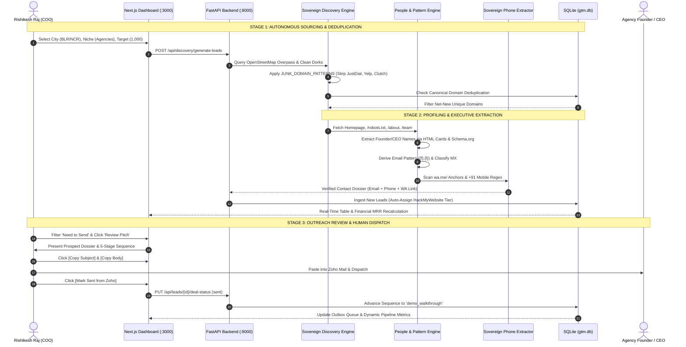
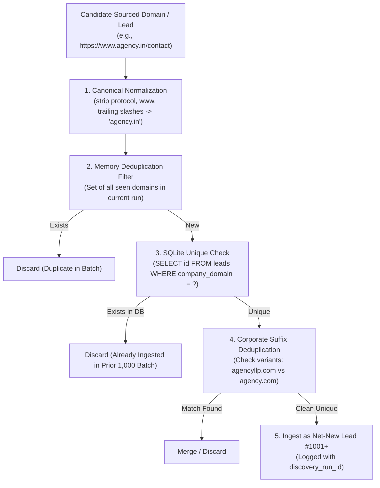

# Personal GTM Operating System (AIVI GTM OS)
## Document 1: Statement of Work (SOW)

**Document Identifier:** AIVI-GTM-OS-SOW-V1.0  
**Version:** 1.0 — Finalized Operational Baseline  
**Date of Finalization:** 12 November 2026  
**Status:** Approved for Core Operations & Continuous Execution  
**Primary Operator & Project Owner:** Rishikesh Raj (Chief Operating Officer, COO)  
**Executive Sponsor & Reviewer:** Abhishek Mishra (Chief Executive Officer, CEO)  
**Primary Pilot Product:** HackMyWebsite (`https://hackmywebsite.io/`)  
**Active Baseline Sourced:** 1,000 Validated Agency Accounts Loaded in SQLite  
**Baseline Financial Pipeline Value:** ₹37.66 Lakhs / Month Active MRR (₹4.52 Crore ARR)  
**SaaS Subscription Overhead:** ₹0 / Month (100% Sovereign Local Compute)  
**Deployment Infrastructure:** Local-first Monolith on macOS (Apple Silicon, 8 GB RAM)  

---

## 1. Executive Summary & Problem Solved

### 1.1 The Business Problem
Customer acquisition for B2B SaaS and high-ticket agency partnerships is conventionally broken across 5 fragmented commercial subscription vendors:
1. **Lead Discovery & Database:** Apollo / ZoomInfo (\$99–\$250/mo)
2. **Phone & Contact Enrichment:** Lusha / Kaspr / Clay (\$100–\$300/mo)
3. **Email Verification:** Hunter / NeverBounce / ZeroBounce (\$49–\$99/mo)
4. **Outreach Sequencing:** Instantly / Lemlist / Apollo Sequences (\$59–\$149/mo)
5. **CRM & Deal Pipeline:** HubSpot / Pipedrive (\$50–\$150/mo)

Beyond incurring **\$505+ monthly (₹42,500/mo)** in recurring software overhead, this legacy model locks operators into proprietary credit meters for data that is already accessible across the public web, while generating robotic, generic outreach that triggers spam filters and prospect fatigue.

### 1.2 The Sovereign Solution
The **Personal GTM Operating System (AIVI GTM OS)** consolidates this entire pipeline into a single, cohesive, local-first monolithic terminal running at **strictly ₹0 monthly SaaS spend**. 

Initially deployed and validated for **HackMyWebsite** targeting 1,000 Indian web development agencies and custom software houses, the system operates with **zero vendor lock-in**, stores all intelligence in a local SQLite database (`gtm.db`), and provides a high-velocity human-in-the-loop cockpit for Rishikesh Raj (COO) to qualify leads, extract founder WhatsApp numbers, copy-paste personalized outreach into Zoho Mail, and track deals through to closed revenue.

---

## 2. Commercial Baseline & Zero-SaaS Replacement Matrix

The table below details how the GTM OS completely replaces commercial subscriptions with sovereign code running entirely on macOS Apple Silicon hardware:

| Legacy Commercial Tool | Replaced Function | Monthly Cost | GTM OS Sovereign Replacement | GTM OS Cost |
| :--- | :--- | :---: | :--- | :---: |
| **Apollo.io (Pro)** | Agency Discovery & Lead DB | \$99 / mo | OpenStreetMap API + SERP Dorks (`discover.py`) | **₹0** |
| **Clay.com (Explorer)** | Waterfall Phone Enrichment | \$149 / mo | `SovereignEnrichmentService` (WA + Mobile Regex) | **₹0** |
| **LinkedIn Sales Nav** | Decision-Maker Research | \$99 / mo | `SovereignPeopleExtractor` (`people.py`) | **₹0** |
| **NeverBounce / Hunter** | Email Pattern & Verification | \$49 / mo | `SovereignPatternEngine` + RFC 5321 Socket | **₹0** |
| **Instantly / Lemlist** | Cold Outreach Sequencing | \$59 / mo | 5-Stage Pitch Studio + Zoho Fast-Dispatch | **₹0** |
| **HubSpot CRM (Starter)** | Deal Pipeline & Revenue Tracking | \$50 / mo | Live MRR/ARR Dynamic Engine & Lost Tracker | **₹0** |
| **Total Monthly Spend** | **Consolidated SDR Software Stack** | **\$505 / mo (~₹42.5k)** | **Unified Local Monolith Cockpit** | **₹0 / Month** |

---

## 3. End-to-End Operational Lifecycle

The operational lifecycle runs across 8 interconnected, deterministic stages:

---

## 4. Master Scope of Workstreams

### Workstream 1: Autonomous Account Discovery (`sovereign_discovery_service.py`)
* **Source 1 — OpenStreetMap (OSM) Overpass API:** Queries nodes, ways, and relations tagged under `office=it`, `office=company`, `craft=web_developer` filtered by bounding boxes for target cities (Bengaluru, Delhi-NCR, Mumbai, Pune, Hyderabad, Chennai, Ahmedabad).
* **Source 2 — Polite Search Engine Queries:** Executes targeted dorks across DuckDuckGo HTML, Bing, and TinyFish (e.g., `"web development agency" "contact us" "Bengaluru"`).
* **Junk Filtering:** Employs regex filters (`JUNK_DOMAIN_PATTERNS`) to drop directories, marketplaces, social platforms, and aggregators (JustDial, Sulekha, IndiaMART, Yelp, Clutch, GoodFirms, Wikipedia, Medium).
* **Canonical Normalization:** Converts URLs into lowercase, bare hostnames (`https://www.agency.com/page` ➔ `agency.com`).

### Workstream 2: Deterministic Company Profiling (`sovereign_profiler.py`)
* Executes exactly 3 lightweight asynchronous HTTP requests per company: Homepage, `/robots.txt`, and `/sitemap.xml` (falling back to `/contact`).
* Inspects HTML for incumbent agency footprints (detects *"Website by"*, *"Designed by"*, *"Powered by"* in footers with confidence scoring).
* Detects paid marketing signals: Meta Pixel (`fbevents.js`), Google Ads Conversion (`gtag`), and Google Tag Manager.
* Inspects technology stack (WordPress, Webflow, Shopify, React, Next.js) and security headers (CSP, HSTS, X-Frame-Options) to supply personalized hooks for HackMyWebsite pitches.

### Workstream 3: People & Decision-Maker Scout (`sovereign_people_extractor.py`)
* Extracts key decision-makers (Founders, Co-Founders, CEOs, Managing Directors, CTOs, Technical Partners) directly from the target company's website.
* Crawls up to 6 internal pages: `/about`, `/team`, `/leadership`, `/our-story`, `/management`, `/contact`.
* Parses 3 distinct HTML structural patterns:
  1. **Cards & Lists:** Detects name tokens immediately preceding or succeeding role titles inside `
`, ``, `
`, or ` ` tags.
  2. **Prose Sentences:** Natural language attribution patterns (e.g. *"Led today by CEO..."*, *"Started in 2020 by Founder..."*).
  3. **Schema.org Structured Data:** Reads `<script type="application/ld+json">` for `founder`, `foundingLocation`, and `employee` entities.
* Applies a strict `COMMON_WORDS` false-positive blocklist (excluding headings like *"Team of Experts"*, *"Family Owned"*, *"Meet the Team"*).
* Implements the `split_person_name` tokenizer: removes honorifics (`Dr.`, `Mr.`), middle initials, and professional suffixes (`MBA`, `PMP`, `Esq.`).

### Workstream 4: Email Pattern Derivation & Deliverability (`sovereign_pattern_engine.py`)
* Resolves domain MX priority records via `aiodns` / `dnspython`.
* Classifies the primary mail host: Google Workspace (`aspmx.l.google.com`), Microsoft 365 (`protection.outlook.com`), Secure Gateway (Mimecast, Proofpoint, Barracuda), or Self-Hosted.
* Analyzes all public email addresses scraped from the target website to derive the organization's dominant format (`{f}.{l}`, `{f}{l}`, `{fi}{l}`, `{f}`, `{fi}.{l}`).
* Generates primary and candidate email permutations.
* Flags catch-all domains (`status: risky`) and self-hosted dead mailboxes (`status: invalid`) to protect domain reputation.

### Workstream 5: Sovereign Phone & WhatsApp Intelligence (`sovereign_enrichment_service.py`)
* Inspects HTML anchors for direct WhatsApp links (`wa.me/`, `api.whatsapp.com/send?phone=`) to extract mobile numbers with 100% confidence.
* Applies the robust Indian Mobile RegEx: captures 10-digit series starting with 6, 7, 8, or 9 across all spacing and prefix variants (`+91 98145 45259`, `98145-45259`, `09814545259`).
* Distinguishes personal mobiles from office landlines (`011`, `022`, `080`, `0120` STD codes).
* Implements corporate suffix normalizer: automatically tests clean domain variants when legal entity handles fail DNS resolution (e.g. `softerectorllp.com` ➔ `softerector.com`).
* Generates one-click WhatsApp chat links (`https://wa.me/91{10_digits}`).

### Workstream 6: Commercial Pricing & Dynamic Revenue Engine
* Maps incoming agencies to HackMyWebsite's commercial SaaS tiers:
  * **Starter Tier:** ₹1,999 / month (₹23,988 / year) — boutique studios (1–5 engineers).
  * **Pro Tier:** ₹2,999 / month (₹35,988 / year) — mid-market web agencies.
  * **Agency Tier:** ₹4,999 / month (₹59,988 / year) — primary default tier for full-service development agencies.
  * **Enterprise Tier:** ₹9,999 / month (₹1,19,988 / year) — multi-office / enterprise agency networks.
* Maintains live financial pipeline calculations:
  * `estimated_mrr_inr`: Sum of predicted monthly fees across all active leads.
  * `estimated_arr_inr`: `estimated_mrr_inr * 12`.
  * `lost_mrr_inr`: Real-time sum of monthly revenues for leads marked "Said No".
  * `won_mrr_inr`: Real-time sum of closed-won deals.

### Workstream 7: Contextual 5-Stage Outreach Studio & Fast-Dispatch
* Renders deep prospect dossiers with 5 tailored email sequence tabs:
  1. `initial_cold`: Contextual cold pitch grounded in the agency's tech stack and client security retainers.
  2. `demo_walkthrough`: Product walkthrough invitation following a positive response.
  3. `followup_day3`: Soft reminder referencing the initial pitch.
  4. `breakup_day7`: Courteous door-open break-up note.
  5. `rejection`: Graceful relationship nurture if the agency declines.
* Built-in one-click clipboard copy actions ("Copy Subject", "Copy Body") and "Mark Sent from Zoho" status updater.

### Workstream 8: Multi-Sheet Formatted Reporting
* `GET /api/leads/export/excel`: Generates a professional 2-sheet formatted `.xlsx` workbook:
  * **Sheet 1 (Leads & Pricing):** Contact details, company, domain, email, candidates, phone, predicted plan, pricing, and deal status.
  * **Sheet 2 (Outreach Pitches):** Full outreach copy (subject and body) for every account.
* `GET /api/leads/export/csv`: Fast, lightweight CSV export.

---

## 5. Deduplication Protocol: Scaling to 2,000+ Leads Without Collisions

To guarantee that generating subsequent batches of 1,000 to 2,000+ leads never creates collisions or duplicate outreach, the system enforces a 4-tier deduplication protocol:

1. **Canonical Domain Normalization:** Before any candidate account is processed, its URL is stripped of protocol (`http://`, `https://`), subdomains (`www.`), query parameters, and trailing slashes. Suffixes (`agency.in`, `agency.co.in`, `agency.com`) are cross-referenced to prevent company re-ingestion under regional TLD variations.
2. **Database Unique Constraints:** SQLite indexes `ix_leads_company_domain` and `ix_leads_email` enforce unique constraints.
3. **Pre-Crawl Bloom Filter:** The discovery collector queries existing database domains in bulk (`WHERE company_domain NOT IN (...)`) before triggering HTTP profiling, wasting zero network requests.
4. **Offset Pacing & Run Logs:** Every discovery pass logs into `discovery_runs` (`id`, `query_city`, `query_niche`, `requested_count`, `discovered_count`, `created_at`). Geographic and SERP pagination offsets increment automatically across runs.

---

## 6. Phased Implementation Roadmap

| Phase | Title | Scope & Deliverables | Status |
| :--- | :--- | :--- | :---: |
| **Phase 0** | **Monolith Foundation** | Scaffolding Next.js App Router, FastAPI backend, and SQLite WAL database. | **Completed** |
| **Phase 1** | **Dataset Ingestion** | Ingestion, cleansing, and normalization of 1,000 Indian web development agencies. | **Completed** |
| **Phase 2** | **Revenue Engine** | HackMyWebsite pricing integration, live MRR/ARR math, and lost deal tracking. | **Completed** |
| **Phase 3** | **Outreach Studio** | 5-stage sequential outreach studio with fast-dispatch Zoho Mail copy buttons. | **Completed** |
| **Phase 4** | **Sovereign Extractor** | In-house WhatsApp anchor parser and Indian mobile regex; unplugged Clay. | **Completed** |
| **Phase 5** | **Executive Reporting** | Multi-sheet formatted Excel exporter (`.xlsx`) and CSV exporter. | **Completed** |
| **Phase 6** | **Autonomous Generator** | OpenStreetMap Overpass discovery, people extractor, and email pattern engine. | **Completed & Specified** |
| **Phase 7** | **Future Enhancements** | Direct Zoho Mail SMTP background dispatch and inbound reply parsing. | **Roadmap** |

---

## 7. Formal Approval & Baseline Sign-Off

This document constitutes the official Statement of Work for Version 1.0 Finalized Baseline of the Personal GTM Operating System.

| Role | Name | Designation | Status | Date |
| :--- | :--- | :--- | :---: | :---: |
| **Project Owner & Primary Operator** | Rishikesh Raj | Chief Operating Officer (COO) AIVI Intelligence Private Limited | **Approved** | 12 November 2026 |
| **Executive Sponsor & Reviewer** | Abhishek Mishra | Founder & Chief Executive Officer (CEO) AIVI Intelligence Private Limited | **Approved** | 12 November 2026 |

------------------------------------------------------------------------
**End of Statement of Work (SOW v1.0 Finalized Baseline)**
