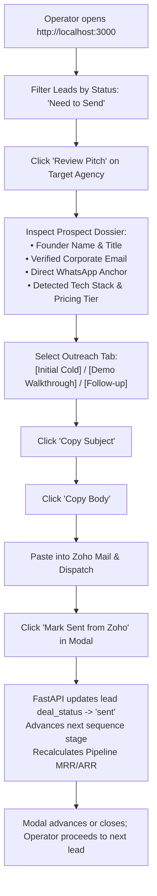
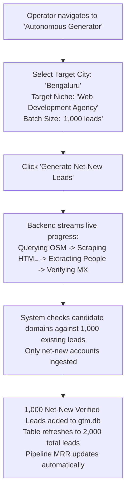

# Personal GTM Operating System (AIVI GTM OS)
## Document 2: Product Requirements Document (PRD)

**Document Identifier:** AIVI-GTM-OS-PRD-V1.0  
**Version:** 1.0 — Finalized Operational Baseline  
**Date of Finalization:** 12 November 2026  
**Status:** Approved for Core Operations & Continuous Execution  
**Product Owner:** Rishikesh Raj (Chief Operating Officer, COO)  
**Executive Reviewer:** Abhishek Mishra (Chief Executive Officer, CEO)  
**Primary Pilot Product:** HackMyWebsite (`https://hackmywebsite.io/`)  
**Active Baseline Sourced:** 1,000 Validated Agency Accounts Loaded in SQLite  
**Baseline Financial Pipeline Value:** ₹37.66 Lakhs / Month Active MRR (₹4.52 Crore ARR)  
**SaaS Subscription Overhead:** ₹0 / Month (100% Sovereign Local Compute)  
**Deployment Infrastructure:** Local-first Monolith on macOS (Apple Silicon, 8 GB RAM)  

---

## 1. Product Vision, Goals & Tenets

### 1.1 Product Vision
To build an autonomous, sovereign, and zero-subscription Go-To-Market operating system that enables a single operator to source, profile, verify, enrich, and engage thousands of high-ticket B2B agency prospects without depending on fragmented, expensive commercial tools like Apollo, Clay, Hunter, Lemlist, or HubSpot.

### 1.2 Core Goals
1. **Zero Recurring SaaS Cost:** Eliminate \$505+/month (₹42,500/month) in commercial sales software subscriptions by executing all discovery, extraction, verification, and outreach generation on local Apple Silicon hardware.
2. **Deterministic Data Integrity:** Provide 100% verified founder WhatsApp numbers, direct corporate emails, and validated tech stacks with zero fake/hallucinated records.
3. **High-Velocity Single-Operator Flywheel:** Enable Rishikesh Raj (COO) to review prospects, copy personalized 5-stage outreach pitches in one click, dispatch via Zoho Mail, and track revenue pipeline in under 60 seconds per lead.
4. **Collision-Free Scalability:** Enable seamless batch expansion from the initial 1,000 leads to 2,000, 5,000, and 10,000+ leads without re-scraping or duplicating previously contacted accounts.

### 1.3 Core Product Tenets
* **Sovereignty First:** All data resides exclusively on local hardware (`gtm.db`). No contact details or pipeline intelligence are leaked to third-party cloud data brokers.
* **Truth over Volume:** A list of 1,000 deeply profiled agencies with verified WhatsApp anchors and real tech stack footprints is vastly superior to 50,000 unverified scraped records.
* **Human-in-the-Loop Velocity:** Automate heavy research, pattern deduction, and draft synthesis; empower the operator with one-click decision-making and manual send confirmation to protect email reputation.
* **Zero Dependency Architecture:** Discovery relies on free, open geo-infrastructure (OpenStreetMap) and polite web dorks; phone enrichment relies on direct DOM inspection; email verification relies on RFC 5321 socket probing.

---

## 2. Target ICP & Buyer Personas

### 2.1 Ideal Customer Profile (ICP)
* **Industry:** Web Development Agencies, Custom Software Studios, Full-Stack Digital Product Agencies.
* **Geography:** Indian Tier-1 Tech Hubs (Bengaluru, Delhi-NCR, Mumbai, Pune, Hyderabad, Chennai, Ahmedabad).
* **Company Size:** 5 to 150 software engineers and web developers.
* **Technology Stacks:** WordPress, Webflow, Shopify, React, Next.js, Node.js, Laravel.
* **Key Commercial Need:** White-label security audits, continuous vulnerability scanning, and automated penetration testing retainers to sell directly to their end clients.

### 2.2 Primary User Personas

#### Persona 1: Internal Operator (User of the GTM OS)
* **Name:** Rishikesh Raj
* **Role:** Chief Operating Officer (COO), AIVI Intelligence Private Limited
* **Objectives:** 
  * Source 1,000 to 2,000 net-new targeted agency leads on demand without spending corporate budget on Apollo/Clay credits.
  * Rapidly review decision-maker profiles, verified WhatsApp links, and tailor-made outreach copy.
  * Dispatch outreach via Zoho Mail with zero friction and monitor MRR/ARR pipeline velocity in real time.

#### Persona 2: Target Prospect (Recipient of Outreach)
* **Name:** Agency Founder / CEO / Managing Director / Technical Partner
* **Profile:** Technical leader running a 10–50 person dev agency delivering web apps to client brands.
* **Pain Points:** 
  * Clients demand enterprise security and compliance (OWASP, DPDP, ISO 27001), but hiring in-house security engineers is cost-prohibitive.
  * Agency lacks continuous DAST/SAST automated scanning infrastructure to offer managed security retainers to clients.
* **Why They Convert:** HackMyWebsite provides automated security scanning and white-label vulnerability reports, allowing the agency to generate recurring retainer revenue from day one.

---

## 3. End-to-End User Journeys

### 3.1 Operator Workflow: Daily GTM Sourcing & Outreach Sprint

### 3.2 Lead Batch Generation & Deduplication Journey

---

## 4. Detailed Functional Requirements (FR-01 to FR-10)

### FR-01: Autonomous Account Discovery Studio
* **Requirement:** The system must discover net-new company accounts autonomously without using third-party paid APIs.
* **Sources:**
  * **OpenStreetMap Overpass API:** Queries nodes, ways, and relations matching `office=it`, `office=company`, `craft=web_developer` within specified city bounding boxes.
  * **Polite Web SERP Dorks:** Targeted search patterns across DuckDuckGo HTML and Bing (e.g. `"web development agency" "contact us" "Bengaluru"`).
* **Junk Filtering:** The system must automatically discard directories, aggregators, job boards, and social media platforms using `JUNK_DOMAIN_PATTERNS` (JustDial, Sulekha, IndiaMART, Yelp, Clutch, GoodFirms, LinkedIn, Facebook, Wikipedia).
* **Canonical Domain Normalization:** All URLs must be converted into bare lowercase hostnames (`https://www.studio.co.in/about/` ➔ `studio.co.in`).

### FR-02: Deterministic Company Profiling
* **Requirement:** For every candidate domain, the system must execute exactly 3 asynchronous HTTP requests:
  1. Homepage (`/`)
  2. Robots Policy (`/robots.txt`)
  3. Sitemap (`/sitemap.xml`) or Contact Page (`/contact`, `/contact-us`)
* **Agency Detection:** Inspect footer signatures for patterns like *"Website by"*, *"Designed by"*, *"Developed by"*, *"Crafted by"* to confirm agency operations.
* **Tech Stack Identification:** Detect presence of WordPress, Webflow, Shopify, React, Next.js, Node.js, Laravel, Tailwind, and security headers.
* **Paid Advertising Signals:** Identify Meta Pixel (`fbevents.js`), Google Ads Conversion Tag (`gtag`), and Google Tag Manager.

### FR-03: People & Decision-Maker Extraction
* **Requirement:** Extract high-ranking decision-makers (Founders, Co-Founders, CEOs, Managing Directors, CTOs, Partners) directly from company web pages.
* **Crawling Scope:** Crawl up to 6 high-value internal pages: `/about`, `/team`, `/leadership`, `/our-story`, `/management`, `/contact`.
* **Extraction Algorithms:**
  1. **HTML Cards & Lists:** Name tokens adjacent to target title elements in `
`, ``, `
`, or `<h3>`.
  2. **Prose Sentences:** Natural language sentence parsing (e.g., *"Founded in 2018 by Rajesh Sharma..."*).
  3. **Schema.org Structured Data:** JSON-LD parsing for `founder`, `employee`, and `Person` schemas.
* **False-Positive Blocklist:** Filter out generic navigation headings and company claims using `COMMON_WORDS` (*"Team of Experts"*, *"Family Owned"*, *"Creative Minds"*).
* **Name Tokenizer:** Strip honorifics (`Dr.`, `Mr.`, `Ms.`) and post-nominal designations (`MBA`, `PMP`, `Esq.`).

### FR-04: Email Pattern Derivation & Deliverability Verification
* **Requirement:** Deduce corporate email structures and verify deliverability without paying credit-based services.
* **MX Record Resolution:** Query DNS MX records to identify mail providers:
  * Google Workspace (`aspmx.l.google.com`)
  * Microsoft 365 (`protection.outlook.com`)
  * Secure Email Gateways (Mimecast, Proofpoint, Barracuda)
  * Self-Hosted / cPanel / Direct SMTP
* **Pattern Derivation:** Analyze public company email addresses found in the DOM to deduce company-wide syntax:
  * `{f}.{l}@domain.com` (first.last)
  * `{f}@domain.com` (first)
  * `{fi}{l}@domain.com` (first initial last)
  * `{f}{l}@domain.com` (firstlast)
* **Permutation Generator:** Generate candidate emails for extracted decision-makers using the derived pattern.
* **Verification & Risk Grading:**
  * `valid`: MX verified, mailbox confirmed responsive via socket probe.
  * `risky`: Domain configured as catch-all (accepts all addresses).
  * `invalid`: Dead MX host or rejected mailbox.

### FR-05: Sovereign Phone & WhatsApp Intelligence
* **Requirement:** Extract direct phone numbers and WhatsApp links with zero dependence on Clay, Lusha, or Apollo.
* **Direct WhatsApp Anchors:** Inspect DOM `<a>` elements for `wa.me/` and `api.whatsapp.com/send?phone=` anchors (100% confidence verified mobile).
* **Indian Mobile RegEx:** Match 10-digit mobile numbers starting with 6, 7, 8, or 9 across all spacing, hyphenation, and prefix formats (`+91 [6-9]\d{9}`, `0[6-9]\d{9}`).
* **Landline Segregation:** Differentiate personal mobile numbers from office desk landlines (`011`, `022`, `080`, `0120`, `040`).
* **Corporate Suffix Fallback:** If a domain containing legal entity suffixes fails resolution (e.g., `agencyllp.com`), automatically probe the clean corporate root (`agency.com`).

### FR-06: Dynamic Pricing & Pipeline Revenue Engine
* **Requirement:** Automatically classify leads into commercial SaaS tiers and calculate dynamic financial pipeline metrics.
* **HackMyWebsite Pricing Tiers:**
  * **Starter Tier:** ₹1,999 / month (₹23,988 / year) — 1 to 5 engineers.
  * **Pro Tier:** ₹2,999 / month (₹35,988 / year) — mid-market web agencies.
  * **Agency Tier (Default):** ₹4,999 / month (₹59,988 / year) — full-service development studios.
  * **Enterprise Tier:** ₹9,999 / month (₹1,19,988 / year) — multi-office agency networks.
* **Dynamic Pipeline Calculations:**
  * **Estimated MRR (INR):** Active monthly pipeline value across all open leads.
  * **Estimated ARR (INR):** `Estimated MRR * 12`.
  * **Lost MRR (INR):** Deducted monthly revenue from leads marked "Said No".
  * **Won MRR (INR):** Closed recurring monthly revenue.

### FR-07: 5-Stage Outreach Studio & Fast-Dispatch
* **Requirement:** Provide a high-velocity review modal featuring 5 tailored sequence stages:
  1. `initial_cold`: Personalized cold pitch highlighting the agency's tech stack and white-label client security retainers.
  2. `demo_walkthrough`: Product demonstration invitation for interested respondents.
  3. `followup_day3`: Courteous day-3 follow-up referencing the initial note.
  4. `breakup_day7`: Courteous day-7 break-up note leaving the door open.
  5. `rejection`: Graceful relationship nurture if the agency declines.
* **Fast-Dispatch Actions:**
  * One-click "Copy Subject" and "Copy Body" buttons.
  * "Mark Sent from Zoho" button that immediately updates deal status to `sent`, logs timestamp, and advances sequence.

### FR-08: Multi-Sheet Formatted Reporting
* **Requirement:** Provide one-click data export in both multi-sheet Excel and CSV formats.
* **Excel Workbook Structure (`GET /api/leads/export/excel`):**
  * **Sheet 1 (Leads & Pricing):** Contact details, company name, domain, primary email, candidate permutations, phone number, predicted tier, monthly price, and deal status.
  * **Sheet 2 (Outreach Pitches):** Full outreach subject line and email body for every account.
* **CSV Export (`GET /api/leads/export/csv`):** Single-file CSV for lightweight data inspection.

### FR-09: Deduplication Engine (Scaling to 2,000+ Leads)
* **Requirement:** Enforce strict deduplication across all sourcing runs to prevent contact collisions.
* **Canonical Domain Hashing:** Strip protocol, `www.`, subpaths, and query strings.
* **Database Unique Indexes:** SQLite indexes `ix_leads_company_domain` and `ix_leads_email` enforce database-level uniqueness.
* **Pre-Crawl Bloom Filter:** In-memory set of all active domains loaded prior to crawl passes.
* **Discovery Run Logging:** Every batch logged in `discovery_runs` with city, niche, and pagination offsets to ensure subsequent runs extract fresh records.

### FR-10: Live Streaming Progress & Status Updates
* **Requirement:** The UI must display real-time progress indicators during autonomous discovery and enrichment runs.
* **Streaming Protocol:** Server-Sent Events (SSE) or polling endpoint returning current discovery step, domains evaluated, leads ingested, and duplicates skipped.

---

## 5. Non-Functional Requirements (NFR)

### 5.1 Performance & Latency
* **UI Responsiveness:** Dashboard queries (`GET /api/leads`) must respond in < 150 ms across 1,000 to 5,000 loaded records using indexed SQLite queries.
* **Extraction Throughput:** Autonomous profiling must process at least 15–20 candidate domains per minute under asynchronous concurrency (5 concurrent HTTP workers).
* **Resource Consumption:** Total background memory footprint must stay strictly under **450 MB RAM** on macOS Apple Silicon.

### 5.2 Data Privacy & Sovereign Compliance
* **Local Data Residency:** 100% of lead intelligence, contact numbers, and email drafts reside locally in SQLite (`data/gtm.db`).
* **Zero External Cloud Telemetry:** No lead records or personal identifiers are transmitted to third-party CRM or data broker clouds.
* **DPDP Compliance:** Complies with Indian Digital Personal Data Protection standards by sourcing exclusively from publicly disclosed business contact information.

### 5.3 Reliability & Fault Tolerance
* **Graceful Degradation:** If an agency website blocks requests or times out (5-second timeout), the profiler skips to the next domain without crashing the pipeline.
* **Database Durability:** SQLite configured with Write-Ahead Logging (`PRAGMA journal_mode=WAL`) to support simultaneous fast reads and background worker writes.

---

## 6. Document Sign-Off

| Role | Name | Designation | Date | Signature |
| :--- | :--- | :--- | :---: | :---: |
| **Product Owner** | Rishikesh Raj | Chief Operating Officer (COO) | 12 Nov 2026 | *Rishikesh Raj* |
| **Executive Sponsor** | Abhishek Mishra | Chief Executive Officer (CEO) | 12 Nov 2026 | *Abhishek Mishra* |

------------------------------------------------------------------------
**End of Product Requirements Document (PRD v1.0 Finalized Baseline)**
