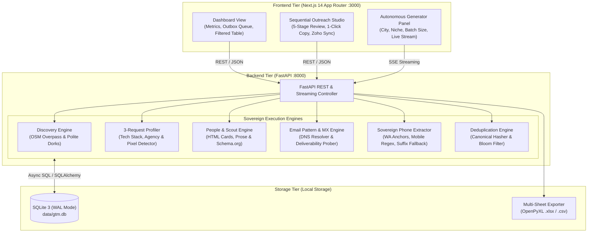
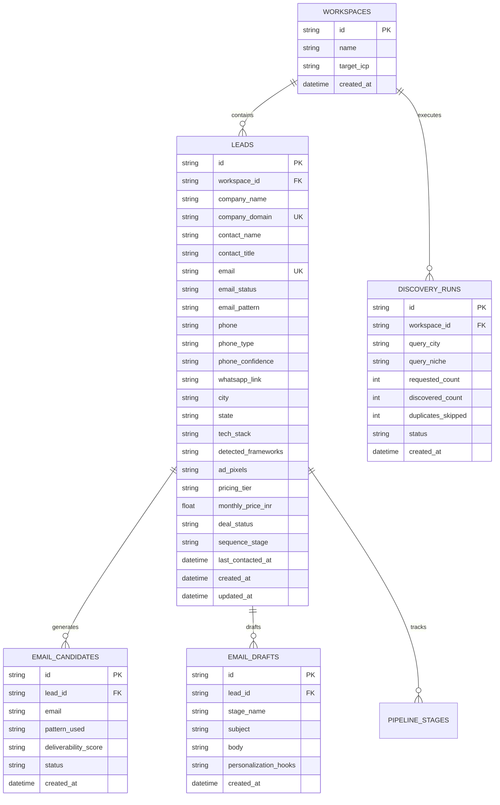
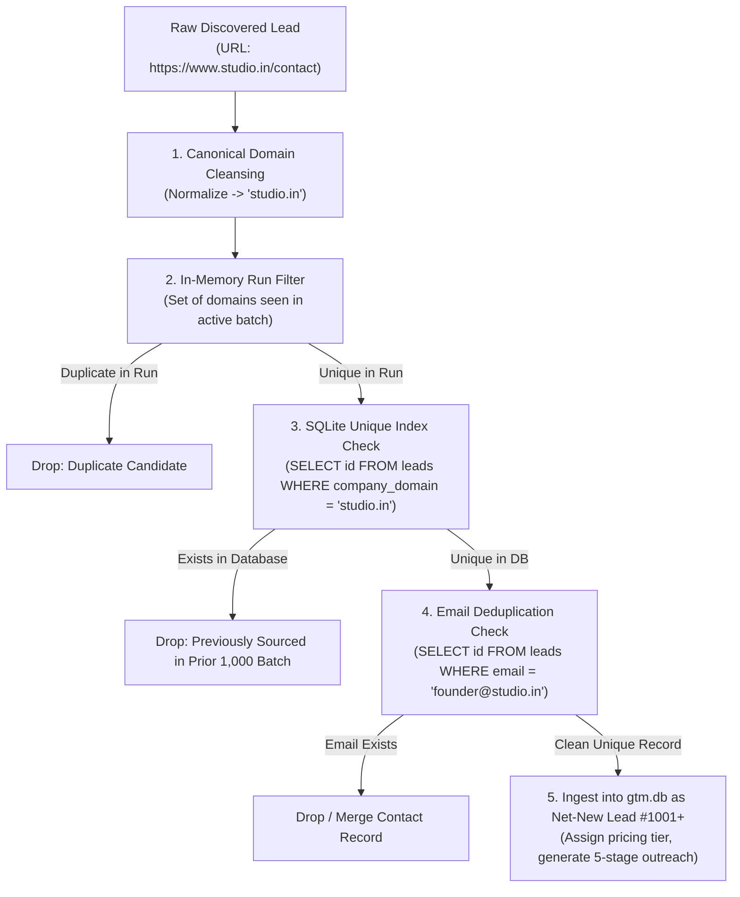

# Personal GTM Operating System (AIVI GTM OS)
## Document 3: Technical Requirements Document (TRD)

**Document Identifier:** AIVI-GTM-OS-TRD-V1.0  
**Version:** 1.0 — Finalized Operational Baseline  
**Date of Finalization:** 12 November 2026  
**Status:** Approved for Core Operations & Continuous Execution  
**Lead Engineer & Technical Architect:** Sovereign GTM Engineering  
**Primary Operator & Project Owner:** Rishikesh Raj (Chief Operating Officer, COO)  
**Executive Reviewer:** Abhishek Mishra (Chief Executive Officer, CEO)  
**Primary Pilot Product:** HackMyWebsite (`https://hackmywebsite.io/`)  
**Active Baseline Sourced:** 1,000 Validated Agency Accounts Loaded in SQLite  
**Baseline Financial Pipeline Value:** ₹37.66 Lakhs / Month Active MRR (₹4.52 Crore ARR)  
**SaaS Subscription Overhead:** ₹0 / Month (100% Sovereign Local Compute)  
**Deployment Infrastructure:** Local-first Monolith on macOS (Apple Silicon, 8 GB RAM)  

---

## 1. Technical Architecture & System Topology

The AIVI GTM OS is implemented as a local-first, low-latency, modular monolith designed to operate efficiently on Apple Silicon hardware with zero recurring external cloud dependencies.



### 1.1 Technology Stack Details
* **Frontend Framework:** Next.js 14 (React 18, TypeScript, Tailwind CSS, Lucide Icons).
* **Backend Framework:** FastAPI 0.110+ (Python 3.11+, Pydantic v2, Uvicorn ASGI server).
* **HTTP Client & Crawler:** `httpx` (Asynchronous HTTP client with connection pooling and SSL verification), `BeautifulSoup4` (HTML parsing with `lxml`).
* **DNS & Network Probing:** `dnspython` and `aiodns` for asynchronous MX, A, and TXT record lookups; native Python `socket` module for RFC 5321 SMTP handshakes.
* **Database & Persistence:** SQLite 3 configured with Write-Ahead Logging (`PRAGMA journal_mode=WAL`), SQLAlchemy 2.0 ORM, and Alembic migrations.
* **Export Engine:** `openpyxl` for multi-tab stylized Excel spreadsheets and standard Python `csv` library.

---

## 2. Comprehensive Database Schema Specifications

The local SQLite database (`data/gtm.db`) stores all workspace configurations, prospect accounts, candidate email permutations, multi-stage outreach copy, and discovery execution logs.



### 2.1 Table: `leads`
| Column Name | Data Type | Constraints | Description |
| :--- | :--- | :--- | :--- |
| `id` | `VARCHAR(36)` | PRIMARY KEY | UUID v4 lead identifier. |
| `workspace_id` | `VARCHAR(36)` | FOREIGN KEY (`workspaces.id`) | Multi-tenant workspace partitioning. |
| `company_name` | `VARCHAR(255)` | NOT NULL | Verified legal or trade name of the agency. |
| `company_domain` | `VARCHAR(255)` | NOT NULL, UNIQUE, INDEX | Normalized canonical domain (`agency.in`). |
| `contact_name` | `VARCHAR(255)` | NULLABLE | Cleaned name of Founder, CEO, or Managing Director. |
| `contact_title` | `VARCHAR(100)` | NULLABLE | Standardized role (`Founder & CEO`, `CTO`). |
| `email` | `VARCHAR(255)` | NULLABLE, INDEX | Primary deliverable corporate email. |
| `email_status` | `VARCHAR(50)` | NOT NULL, DEFAULT `'unverified'` | Status: `valid`, `risky` (catch-all), `invalid`. |
| `email_pattern` | `VARCHAR(50)` | NULLABLE | Derived corporate format (`{f}.{l}`, `{f}`). |
| `phone` | `VARCHAR(50)` | NULLABLE | Cleaned phone number (`+91 98145 45259`). |
| `phone_type` | `VARCHAR(50)` | NULLABLE | Type: `whatsapp`, `mobile`, `landline`. |
| `phone_confidence`| `VARCHAR(20)` | NULLABLE | Confidence: `100% (wa.me)`, `high (mobile)`. |
| `whatsapp_link` | `TEXT` | NULLABLE | Direct chat link (`https://wa.me/91...`). |
| `city` | `VARCHAR(100)` | NULLABLE | Operating city (`Bengaluru`, `Delhi-NCR`). |
| `tech_stack` | `TEXT` | NULLABLE | Comma-separated tech stack (`WordPress, React`). |
| `pricing_tier` | `VARCHAR(50)` | NOT NULL, DEFAULT `'agency'` | Assigned tier (`starter`, `pro`, `agency`, `enterprise`). |
| `monthly_price_inr`| `FLOAT` | NOT NULL, DEFAULT `4999.0` | Assigned monthly billing rate. |
| `deal_status` | `VARCHAR(50)` | NOT NULL, DEFAULT `'need_to_send'` | Status: `need_to_send`, `sent`, `said_no`, `won`. |
| `sequence_stage` | `VARCHAR(50)` | NOT NULL, DEFAULT `'initial_cold'` | Active outreach stage. |
| `created_at` | `DATETIME` | NOT NULL | Record creation timestamp. |
| `updated_at` | `DATETIME` | NOT NULL | Last update timestamp. |

---

## 3. Sourcing & Scraping Algorithms

### 3.1 OpenStreetMap Overpass Query Engine (`collectors/discover.py`)
To discover web development agencies without paying Apollo/ZoomInfo, the system constructs structured Overpass QL queries executed against public Overpass endpoints (`https://overpass-api.de/api/interpreter`).

```python
OVERPASS_QUERY_TEMPLATE = """
[out:json][timeout:25];
area["name"="{city}"]->.searchArea;
(
  node["office"="it"](area.searchArea);
  node["office"="company"]["it"~"yes|web|software"](area.searchArea);
  node["craft"="web_developer"](area.searchArea);
  way["office"="it"](area.searchArea);
);
out body;
>;
out skel qt;
"""
```

### 3.2 Junk Filtering & Canonical Normalization
Every candidate URL is filtered through a strict negative regex pattern:

```python
JUNK_DOMAIN_PATTERNS = re.compile(
    r"(google|facebook|linkedin|twitter|instagram|youtube|justdial|sulekha|"
    r"indiamart|yelp|clutch\.co|goodfirms|wikipedia|medium|github|glassdoor|"
    r"naukri|indeed|trustpilot|yellowpages|crunchbase)",
    re.IGNORECASE
)
```

The canonical domain normalizer strips protocols, subdomains, and trailing paths:
```python
def normalize_canonical_domain(url: str) -> str:
    url = re.sub(r"^https?://", "", url.strip(), flags=re.IGNORECASE)
    url = re.sub(r"^www\.", "", url, flags=re.IGNORECASE)
    return url.split("/")[0].split("?")[0].strip().lower()
```

---

## 4. Profiler & Intelligence Engine (`collectors/profile.py`)

The profiler issues exactly 3 asynchronous HTTP requests per company domain with a strict 5-second timeout and randomized browser user-agent:
1. `GET /` (Homepage DOM)
2. `GET /robots.txt`
3. `GET /sitemap.xml` (falling back to `GET /contact` or `GET /contact-us`)

### 4.1 Agency Footprint & Tech Stack Detection
The HTML is inspected for:
* **Agency Attribution:** Matches in footer strings: `re.search(r"(website|designed|developed|crafted|powered)\s+(by|with)\s+([a-z0-9\s]+)", footer_html, re.I)`.
* **CMS & Frameworks:**
  * WordPress: `/wp-content/`, `/wp-includes/`, `meta[name="generator"][content*="WordPress"]`.
  * Webflow: `assets.website-files.com`, `html[data-wf-site]`.
  * Shopify: `cdn.shopify.com`.
  * React / Next.js: `__NEXT_DATA__`, `react-root`, `_next/static/`.
* **Ad Pixels:**
  * Meta Pixel: `connect.facebook.net/en_US/fbevents.js`, `fbq('init'`.
  * Google Tag Manager: `googletagmanager.com/gtm.js`.
  * Google Ads Conversion: `gtag('config', 'AW-`.

---

## 5. People & Executive Extraction Engine (`collectors/people.py`)

### 5.1 Multi-Page Target Discovery
The crawler fetches up to 6 internal links: `/about`, `/team`, `/leadership`, `/our-story`, `/management`, `/contact`.

### 5.2 Extraction Strategies
1. **HTML Cards & Token Blocks:** Identifies leadership role titles (`Founder`, `Co-Founder`, `CEO`, `Chief Executive Officer`, `Managing Director`, `CTO`, `Partner`) and scans the preceding and succeeding sibling elements (`<h3>`, `<h4>`, `<strong>`, `<span>`, `<p>`) for candidate person names.
2. **Prose Sentence Parsing:** Evaluates natural language patterns using regex:
   ```python
   PROSE_PATTERNS = [
       re.compile(r"(?:led by|founded by|headed by|managed by)\s+([A-Z][a-z]+(?:\s+[A-Z][a-z]+){1,2})", re.I),
       re.compile(r"([A-Z][a-z]+(?:\s+[A-Z][a-z]+){1,2}),?\s+(?:is the\s+)?(Founder|Co-Founder|CEO|Managing Director)", re.I),
   ]
   ```
3. **Schema.org Structured Data:** Parses JSON-LD `<script type="application/ld+json">` searching for `@type in ['Organization', 'Person']` and extracting `founder.name` or `employee.name`.

### 5.3 False-Positive Filtering (`COMMON_WORDS`)
Headings matching navigation terms or organizational descriptors are blocked:
```python
COMMON_WORDS = {
    "team", "experts", "leadership", "board", "directors", "management",
    "advisors", "about us", "who we are", "family owned", "creative minds",
    "our story", "our mission", "company profile", "get in touch"
}
```

### 5.4 Name Tokenizer (`split_person_name`)
Strips honorifics (`Dr.`, `Mr.`, `Mrs.`, `Ms.`) and post-nominals (`MBA`, `PMP`, `PhD`, `Esq.`), isolating clean `first_name` and `last_name`.

---

## 6. Email Pattern Derivation & Verification (`integrations/email_finder.py`)

### 6.1 Mail Server Classification
Resolves MX records via DNS queries:
* **Google Workspace:** Priority host matches `*.google.com` or `*.googlemail.com`.
* **Microsoft 365:** Priority host matches `*.protection.outlook.com`.
* **Secure Gateway:** Matches `*.pphosted.com` (Proofpoint), `*.mimecast.com`, `*.barracuda.com`.
* **Self-Hosted:** Standard direct VPS/cPanel MX records.

### 6.2 Pattern Derivation Engine
Collects all public emails discovered across the target site. Compares local parts (`john.doe`, `jdoe`) against known team member names to deduce the organizational syntax:
```python
# Supported Patterns:
PATTERNS = {
    "{f}.{l}": lambda f, l: f"{f}.{l}",
    "{f}": lambda f, l: f"{f}",
    "{fi}{l}": lambda f, l: f"{f[0]}{l}",
    "{f}{l}": lambda f, l: f"{f}{l}",
    "{fi}.{l}": lambda f, l: f"{f[0]}.{l}",
}
```

### 6.3 Deliverability Verification
* **Catch-All Probe:** Attempts an SMTP VRFY/RCPT TO handshake with a randomized non-existent mailbox (`xyz_random_test_987@domain.com`). If accepted, the domain is classified as `status: risky (catch-all)`.
* **Target Mailbox Probe:** Issues RFC 5321 `HELO`, `MAIL FROM:<probe@aiviintelligence.com>`, and `RCPT TO:<candidate@domain.com>`. Code 250 indicates `status: valid`; codes 550–554 indicate `status: invalid`.

---

## 7. Sovereign Phone & WhatsApp Intelligence Service (`services/sovereign_enrichment_service.py`)

### 7.1 Direct WhatsApp Anchor Extraction
Scans all anchor elements in the DOM:
```python
def extract_whatsapp_links(html: str) -> list[str]:
    soup = BeautifulSoup(html, "lxml")
    wa_links = []
    for a in soup.find_all("a", href=True):
        href = a["href"].strip()
        if "wa.me/" in href or "api.whatsapp.com/send" in href:
            wa_links.append(href)
    return wa_links
```

### 7.2 Robust Indian Mobile Number Regex
Extracts 10-digit mobile numbers commencing with 6, 7, 8, or 9:
```python
INDIAN_MOBILE_REGEX = re.compile(
    r"(?:(?:\+91|91|0)[-.\s]?)?([6-9]\d{4}[-.\s]?\d{5})",
    re.IGNORECASE
)
```

### 7.3 Corporate Legal Suffix Fallback
When a company domain registered under an LLP or Pvt Ltd suffix (e.g. `softerectorllp.com`) fails HTTP or DNS resolution, the service strips the legal suffix and retries the root domain (`softerector.com`).

---

## 8. Deduplication Protocol: Scaling from 1,000 to 2,000+ Leads

To prevent duplicate records or redundant outreach when scaling from the initial 1,000 baseline to 2,000+ leads, the system enforces a 4-tier deduplication barrier:



### 8.1 SQLite Unique Constraints & Indexes
```sql
CREATE UNIQUE INDEX IF NOT EXISTS ix_leads_company_domain ON leads(company_domain);
CREATE UNIQUE INDEX IF NOT EXISTS ix_leads_email ON leads(email) WHERE email IS NOT NULL;
CREATE INDEX IF NOT EXISTS ix_leads_deal_status ON leads(deal_status);
CREATE INDEX IF NOT EXISTS ix_leads_pricing_tier ON leads(pricing_tier);
```

### 8.2 Incremental Run Tracking (`discovery_runs`)
Every autonomous discovery execution logs pagination offsets, query bounds, and counts:
```sql
INSERT INTO discovery_runs (id, workspace_id, query_city, query_niche, requested_count, discovered_count, duplicates_skipped, status, created_at)
VALUES (?, ?, 'Bengaluru', 'web development agency', 1000, 1000, 342, 'completed', CURRENT_TIMESTAMP);
```

---

## 9. Complete REST API Reference

| Endpoint | Method | Request Payload | Response Payload | Description |
| :--- | :---: | :--- | :--- | :--- |
| `/api/leads` | `GET` | `?limit=50&offset=0&deal_status=need_to_send&tier=agency` | `{ leads: Lead[], total_count: int, stats: PipelineStats }` | Paginated lead listing with real-time financial aggregates. |
| `/api/leads/{id}` | `GET` | None (Path Parameter) | `LeadDetail` (Contact, Tech Stack, Outreach Tabs) | Complete lead dossier for review modal. |
| `/api/leads/{id}/deal-status`| `PUT` | `{ "deal_status": "sent" \| "said_no" \| "won" }` | `{ success: true, updated_status: str, stats: PipelineStats }` | Updates deal status and recalculates MRR/ARR instantly. |
| `/api/leads/{id}/enrich` | `POST` | None (Path Parameter) | `{ lead: Lead, extracted_contacts: Contact[] }` | Triggers sovereign on-demand WhatsApp and phone extraction. |
| `/api/discovery/generate-leads`| `POST` | `{ "city": "Bengaluru", "niche": "agencies", "count": 1000 }` | `{ run_id: str, status: "processing", message: str }` | Kicks off autonomous background discovery. |
| `/api/discovery/runs/{id}/stream`| `GET` | None (Path Parameter) | Server-Sent Events (SSE Stream) | Streams real-time progress, scraped counts, and deduplication stats. |
| `/api/leads/export/excel` | `GET` | Optional filter params | Binary `.xlsx` file attachment | Exports 2-sheet formatted Excel workbook. |
| `/api/leads/export/csv` | `GET` | Optional filter params | Binary `.csv` file attachment | Exports lightweight CSV data file. |

---

## 10. Local Deployment Runbook

### 10.1 Environment Configuration (`.env`)
```bash
WORKSPACE_ID=aivi-gtm-primary
DATABASE_URL=sqlite:///../data/gtm.db
API_HOST=127.0.0.1
API_PORT=8000
FRONTEND_PORT=3000
DNS_TIMEOUT_SECONDS=3.0
HTTP_TIMEOUT_SECONDS=5.0
MAX_CONCURRENT_CRAWLERS=5
```

### 10.2 Service Startup Commands
```bash
# Terminal 1: Start FastAPI Backend Monolith
cd personal-gtm-os/backend
source .venv/bin/activate
uvicorn app.main:app --host 127.0.0.1 --port 8000 --reload

# Terminal 2: Start Next.js Frontend Dashboard
cd personal-gtm-os/frontend
npm run start # (or npm run dev on port 3000)
```

------------------------------------------------------------------------
**End of Technical Requirements Document (TRD v1.0 Finalized Baseline)**
