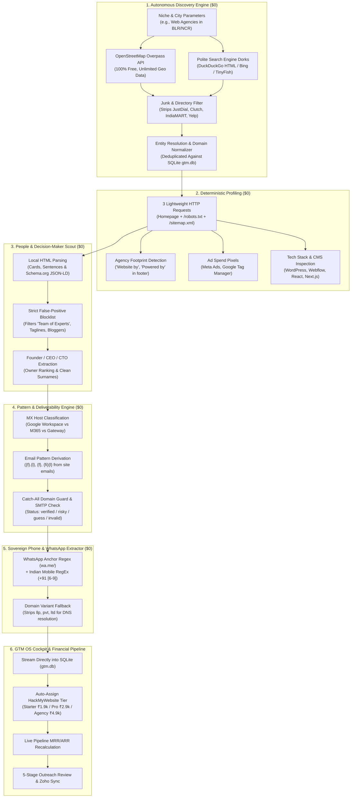
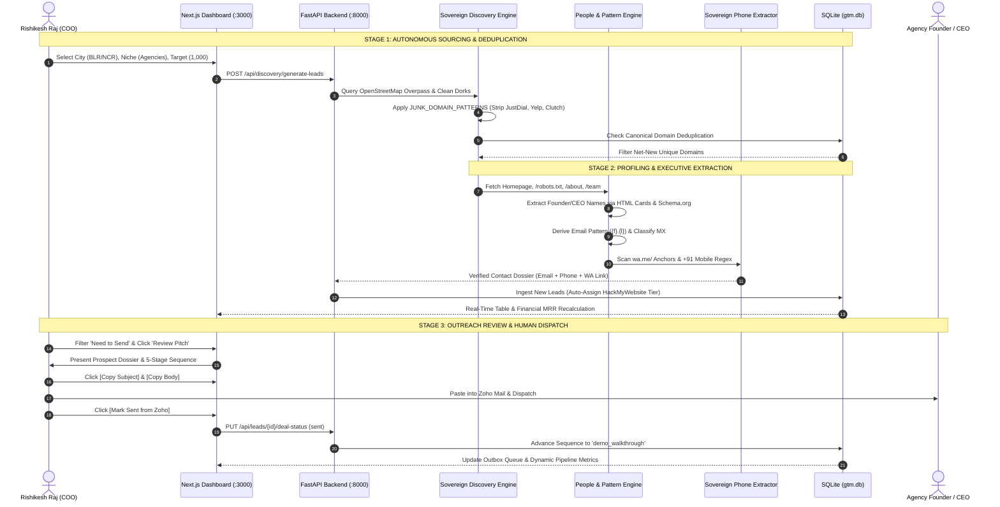
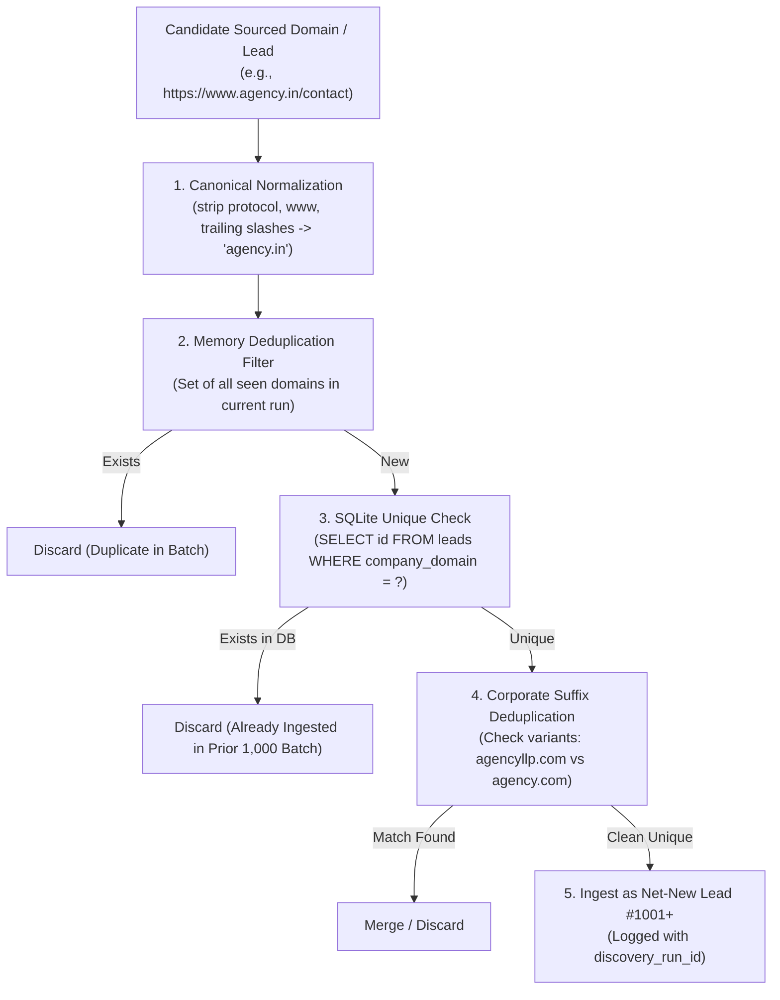
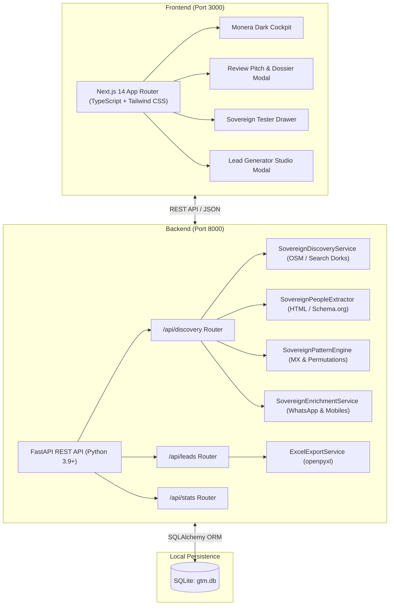
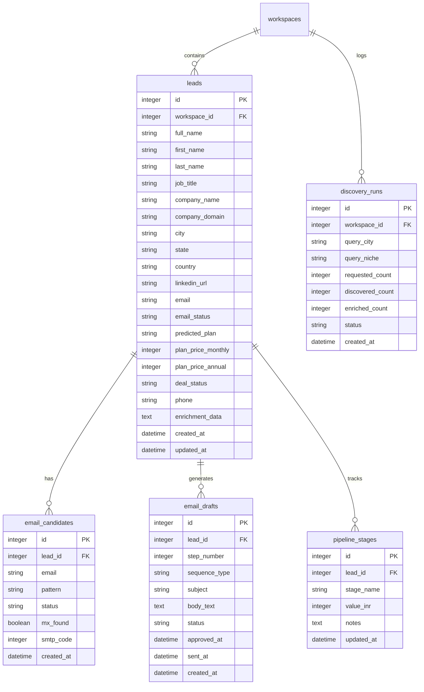

# Personal GTM Operating System (AIVI GTM OS)
## Master Unified Specification: Statement of Work (SOW), Product Requirements (PRD) & Technical Requirements (TRD)

**Document Identifier:** AIVI-GTM-OS-SPEC-V1.0  
**Version:** 1.0 — Finalized Operational Baseline  
**Date of Finalization:** 12 November 2026  
**Status:** Approved for Core Operations & Extensible Feature Expansion  
**Primary Operator & Project Owner:** Rishikesh Raj (Chief Operating Officer, COO)  
**Executive Sponsor & Reviewer:** Abhishek Mishra (Chief Executive Officer, CEO)  
**Initial Pilot Product:** HackMyWebsite (`https://hackmywebsite.io/`)  
**Active Production Baseline:** 1,000 Validated Agency Accounts Loaded in SQLite  
**Baseline Financial Pipeline Value:** ₹37.66 Lakhs / Month Active MRR (₹4.52 Crore ARR)  
**SaaS Subscription Overhead:** ₹0 / Month (100% Sovereign Local Compute)  
**Architectural Benchmark Sources:** Sellbird (`ethanplusai/sellbird`), Harvey (`ethanplusai/harvey`), OpenEnrich, Twenty CRM  
**Deployment Infrastructure:** Local-first Monolith on macOS (Apple Silicon, 8 GB RAM)  

---

## Executive Summary & System Overview

Across the modern B2B SaaS and enterprise sales landscape, outbound customer acquisition has historically been trapped in an expensive, multi-vendor subscription matrix costing **\$400 to \$800+ monthly (₹35,000–₹70,000/mo)**:
1. **Lead Database & Discovery:** Apollo / ZoomInfo (\$99–\$250/mo)
2. **Phone & Contact Enrichment:** Lusha / Kaspr / Clay (\$100–\$300/mo)
3. **Email Verification:** Hunter / NeverBounce / ZeroBounce (\$49–\$99/mo)
4. **Outreach Sequencing:** Instantly / Lemlist / Apollo Sequences (\$59–\$149/mo)
5. **CRM & Deal Pipeline:** HubSpot / Pipedrive (\$50–\$150/mo)

The **Personal GTM Operating System (AIVI GTM OS)** eliminates this recurring software tax by providing a single, local-first monolith designed to operate at **strictly ₹0 monthly SaaS spend**. 

Having already operationalized the core terminal—incorporating 1,000 validated Indian web development agencies, 5-stage contextual outreach sequences, dynamic MRR/ARR financial accounting, and sovereign WhatsApp/phone extraction—**Version 1.0 establishes the finalized operational baseline**.

By reverse-engineering the data acquisition pipelines of Apollo, Clay, and the open-source architectures of **Sellbird** (`ethanplusai/sellbird`) and **Harvey**, the GTM OS introduces an end-to-end, self-contained sourcing loop:
* **Account Discovery:** Free geographic indexing via the OpenStreetMap (OSM) Overpass API and polite search queries, cleansed of directories via regex patterns.
* **Deterministic Profiling:** 3-request HTTP inspection extracting tech stacks, ad spend signals (Meta Ads, Google Tag Manager), and agency footer credits.
* **Decision-Maker Extraction:** Direct extraction of Owners, Founders, CEOs, and CTOs from target websites and Schema.org structured data without third-party scrapers.
* **Pattern & Deliverability Engine:** Derives company email patterns (`{f}.{l}`, `{f}`, `{fi}{l}`) from public addresses, classifies mail servers (Google Workspace, Microsoft 365, Gateways), detects catch-alls, and verifies mailboxes.
* **Sovereign Phone Intelligence:** Automatically uncovers direct WhatsApp links (`wa.me/`) and validated 10-digit Indian mobile numbers (`+91 [6-9]`).
* **Deduplication Engine:** Prevents duplicate lead ingestion when expanding from 1,000 to 2,000, 5,000+ leads through canonical domain normalization, unique database constraints, and city/niche batch tracking.



---

# SECTION 1: STATEMENT OF WORK (SOW)

## 1.1 Commercial Baseline & Zero-SaaS Replacement Matrix

The Personal GTM OS replaces the traditional SDR and data enrichment software stack with sovereign code running entirely on local hardware:

| Legacy Commercial Tool | Replaced Function | Monthly Cost | GTM OS Sovereign Replacement | GTM OS Cost |
| :--- | :--- | :---: | :--- | :---: |
| **Apollo.io (Pro)** | Agency Discovery & Lead DB | \$99 / mo | OpenStreetMap + Search Dorks (`discover.py`) | **₹0** |
| **Clay.com (Explorer)** | Waterfall Enrichment | \$149 / mo | `SovereignEnrichmentService` (Python) | **₹0** |
| **NeverBounce / Hunter** | Email Pattern & Verification | \$49 / mo | `SovereignPatternEngine` + RFC 5321 | **₹0** |
| **LinkedIn Sales Navigator** | Decision-Maker Research | \$99 / mo | `SovereignPeopleExtractor` (`people.py`) | **₹0** |
| **Instantly / Lemlist** | Cold Outreach Sequencing | \$59 / mo | 5-Stage Pitch Studio + Zoho Fast-Dispatch | **₹0** |
| **HubSpot CRM (Starter)** | Deal Pipeline & Revenue Tracking | \$50 / mo | Dynamic Deal Pipeline & Lost MRR Engine | **₹0** |
| **Total Monthly Spend** | **Consolidated SDR Software Stack** | **\$505 / mo (~₹42,500/mo)** | **Unified Local Monolith Cockpit** | **₹0 / Month** |

---

## 1.2 End-to-End Operational Lifecycle & Flowchart

The operational lifecycle is divided into 8 interconnected, deterministic stages:



---

## 1.3 Detailed Workstream Specifications

### Workstream 1: Autonomous Account Discovery (`sovereign_discovery_service.py`)
* **Source 1 — OpenStreetMap (OSM) Overpass API:** Queries nodes, ways, and relations tagged under `office=it`, `office=company`, `craft=web_developer` filtered by bounding boxes for target cities (Bengaluru, Delhi-NCR, Mumbai, Pune, Hyderabad, Chennai, Ahmedabad).
* **Source 2 — Polite Search Engine Queries:** Executes targeted dorks across DuckDuckGo HTML, Bing, and TinyFish (e.g., `"web development agency" "contact us" "Bengaluru"`).
* **Junk Filtering:** Employs regex filters (`JUNK_DOMAIN_PATTERNS`) to drop directories, marketplaces, social platforms, and aggregators (JustDial, Sulekha, IndiaMART, Yelp, Clutch, GoodFirms, Wikipedia, Medium).
* **Canonical Normalization:** Converts URLs into lowercase, bare hostnames (`https://www.agency.com/page` ➔ `agency.com`).

### Workstream 2: Deterministic Company Profiling (`sovereign_profiler.py`)
* Executes 3 lightweight asynchronous HTTP requests: Homepage, `/robots.txt`, and `/sitemap.xml` (or `/contact`).
* Inspects HTML for incumbent agency footprints (*"Website by"*, *"Designed by"* in footer) to identify white-label partnership opportunities.
* Detects paid marketing signals: Meta Pixel (`fbevents.js`), Google Ads Conversion (`gtag`), and Google Tag Manager.
* Detects core tech stacks (WordPress, Webflow, Shopify, React, Next.js) and security posture indicators (missing CSP headers, SSL flags) to generate evidence-backed hooks for HackMyWebsite pitches.

### Workstream 3: People & Decision-Maker Scout (`sovereign_people_extractor.py`)
* Crawls up to 6 internal pages: `/about`, `/team`, `/leadership`, `/our-story`, `/management`, `/contact`.
* Parses 3 distinct HTML structural patterns:
  1. **Cards & Lists:** Detects name tokens immediately preceding or succeeding role titles inside `<div>`, `<span>`, `<p>`, or `<br>` tags.
  2. **Prose Sentences:** Natural language attribution patterns (e.g. *"Led today by CEO..."*, *"Started in 2020 by Founder..."*).
  3. **Schema.org Structured Data:** Reads `<script type="application/ld+json">` for `founder`, `foundingLocation`, and `employee` entities.
* Applies a strict `COMMON_WORDS` false-positive blocklist (excluding headings like *"Team of Experts"*, *"Family Owned"*, *"Meet the Team"*).
* Implements the `split_person_name` tokenizer: removes honorifics (`Dr.`, `Mr.`), middle initials, and professional suffixes (`MBA`, `PMP`, `Esq.`).

### Workstream 4: Email Pattern Derivation & Deliverability (`sovereign_pattern_engine.py`)
* Resolves domain MX priority records via `aiodns` / `dnspython`.
* Classifies the primary mail host: Google Workspace (`aspmx.l.google.com`), Microsoft 365 (`protection.outlook.com`), Secure Gateway (Mimecast, Proofpoint, Barracuda), or Self-Hosted.
* Analyzes all public email addresses scraped from the target website to derive the organization's dominant format (`{f}.{l}`, `{f}{l}`, `{fi}{l}`, `{f}`, `{fi}.{l}`).
* Generates primary and candidate email permutations.
* Flags catch-all domains (`status: risky`) and self-hosted dead mailboxes (`status: invalid`) to protect domain reputation.

### Workstream 5: Sovereign Phone & WhatsApp Intelligence (`sovereign_enrichment_service.py`)
* Inspects HTML anchors for direct WhatsApp links (`wa.me/`, `api.whatsapp.com/send?phone=`) to extract mobile numbers with 100% confidence.
* Applies the robust Indian Mobile RegEx: captures 10-digit series starting with 6, 7, 8, or 9 across all spacing and prefix variants (`+91 98145 45259`, `98145-45259`, `09814545259`).
* Distinguishes personal mobiles from office landlines (`011`, `022`, `080`, `0120` STD codes).
* Implements corporate suffix normalizer: automatically tests clean domain variants when legal entity handles fail DNS resolution (e.g. `softerectorllp.com` ➔ `softerector.com`).
* Generates one-click WhatsApp chat links (`https://wa.me/91{10_digits}`).

### Workstream 6: Commercial Pricing & Dynamic Revenue Engine
* Maps incoming agencies to HackMyWebsite's commercial SaaS tiers:
  * **Starter Tier:** ₹1,999 / month (₹23,988 / year) — boutique studios (1–5 engineers).
  * **Pro Tier:** ₹2,999 / month (₹35,988 / year) — mid-market web agencies.
  * **Agency Tier:** ₹4,999 / month (₹59,988 / year) — primary default tier for full-service development agencies.
  * **Enterprise Tier:** ₹9,999 / month (₹1,19,988 / year) — multi-office / enterprise agency networks.
* Maintains live financial pipeline calculations:
  * `estimated_mrr_inr`: Sum of predicted monthly fees across all active leads.
  * `estimated_arr_inr`: `estimated_mrr_inr * 12`.
  * `lost_mrr_inr`: Real-time sum of monthly revenues for leads marked "Said No".
  * `won_mrr_inr`: Real-time sum of closed-won deals.

### Workstream 7: Contextual 5-Stage Outreach Studio & Fast-Dispatch
* Renders deep prospect dossiers with 5 tailored email sequence tabs:
  1. `initial_cold`: Contextual cold pitch grounded in the agency's tech stack and client security retainers.
  2. `demo_walkthrough`: Product walkthrough invitation following a positive response.
  3. `followup_day3`: Soft reminder referencing the initial pitch.
  4. `breakup_day7`: Courteous door-open break-up note.
  5. `rejection`: Graceful relationship nurture if the agency declines.
* Built-in one-click clipboard copy actions ("Copy Subject", "Copy Body") and "Mark Sent from Zoho" status updater.

### Workstream 8: Multi-Sheet Formatted Reporting
* `GET /api/leads/export/excel`: Generates a professional 2-sheet formatted `.xlsx` workbook:
  * **Sheet 1 (Leads & Pricing):** Contact details, company, domain, email, candidates, phone, predicted plan, pricing, and deal status.
  * **Sheet 2 (Outreach Pitches):** Full outreach copy (subject and body) for every account.
* `GET /api/leads/export/csv`: Fast, lightweight CSV export.

---

## 1.4 Deduplication & Scaling Protocol (From 1,000 to 2,000+ Leads)

To ensure that generating the next 2,000 leads never introduces collisions or duplicate outreach, the GTM OS implements a multi-layer deduplication architecture:



### 1. Canonical Domain Hashing & Normalization
* Before any candidate account is processed, its URL is stripped of protocol (`http://`, `https://`), subdomains (`www.`), query parameters (`?utm_source`), and trailing slashes.
* Suffixes such as `agency.in`, `agency.co.in`, and `agency.com` are cross-referenced to prevent company re-ingestion under regional TLD variations.

### 2. Multi-Layer Database Constraints
* SQLite indexes `ix_leads_company_domain` and `ix_leads_email` enforce unique constraints.
* Sourcing queries perform bulk `WHERE company_domain NOT IN (...)` filtering before invoking the profiling crawler, ensuring zero CPU cycles or network packets are wasted on existing accounts.

### 3. Discovery Run Logging & Offset Pacing
* Every execution logs into `discovery_runs` (`id`, `query_city`, `query_niche`, `requested_count`, `discovered_count`, `created_at`).
* Geographic and SERP pagination offsets increment automatically across runs. If Run 1 queried Bengaluru positions 1–50, Run 2 automatically starts at offset 51, preventing query overlap.

---

# SECTION 2: PRODUCT REQUIREMENTS DOCUMENT (PRD)

## 2.1 Product Vision & Core Tenets

The Personal GTM OS is an executive outbound cockpit that empowers a lean executive team (COO and CEO) to discover, research, verify, and close B2B accounts at scale without monthly software bills.

### Operating Tenets:
1. **Zero SaaS Overhead:** Every feature must run on local compute or free-tier protocols. No mandatory third-party subscriptions.
2. **Human-in-the-Loop Governance:** AI drafts outreach and extracts intelligence; the human operator reviews, edits, and authorizes every external touchpoint.
3. **Zero Fabrication:** Contact numbers, emails, and company pain points must derive from verifiable public digital assets or RFC protocols.
4. **Instant Actionability:** Every lead view must offer one-click actions: copy email, switch candidate, call phone, open WhatsApp chat, copy pitch, or mark pipeline status.
5. **Real-Time Financial Integrity:** Every pipeline change immediately reflects in active MRR, ARR, and lost revenue metrics.

---

## 2.2 Target ICP & Buyer Personas

### Ideal Customer Profile (ICP):
* **Industry:** Custom Web Development Agencies, Software Engineering Studios, WordPress/Webflow Agencies, Mobile App Houses, Digital Transformation Consultancies.
* **Geography:** India (Primary: Bengaluru, Delhi-NCR, Mumbai, Pune, Hyderabad, Chennai, Ahmedabad).
* **Company Size:** 5 to 150 employees (agencies with active client maintenance retainers).
* **Target Roles:** Founder, Co-Founder, Chief Executive Officer (CEO), Managing Director (MD), Chief Technology Officer (CTO), Partner.
* **Core Pain Point Addressed:** Web development agencies are legally and contractually liable for the security of code delivered to clients. HackMyWebsite provides automated DAST/SAST penetration testing and a GitHub PR Security Gateway that agencies white-label or bundle into high-margin client maintenance retainers.

### User Personas:
1. **Rishikesh Raj (COO / Primary Operator):** Executes high-velocity daily outbox reviews, pitch qualification, manual copy-paste to Zoho Mail, WhatsApp outreach, and deal status progression.
2. **Abhishek Mishra (CEO / Executive Sponsor):** Reviews macro pipeline financial metrics (MRR/ARR growth, loss reasons), audits conversion rates, and participates in high-value enterprise demos.
3. **Prospect Persona (Agency Founder / CTO):** Receives non-generic, evidence-grounded cold outreach citing their actual agency tech stack, portfolio projects, or security gaps.

---

## 2.3 Detailed Functional Requirements (FRD)

### FR-01: Autonomous Lead Generator Studio
* **FR-01.1:** The dashboard shall provide a **"⚡ Generate Net-New Leads"** control bar allowing the operator to select City/Region, Sub-Niche, and Batch Size (50, 100, 250, 500).
* **FR-01.2:** Sourcing shall draw from OpenStreetMap Overpass API and search dorks, discarding all records matching `JUNK_DOMAIN_PATTERNS`.
* **FR-01.3:** System shall verify canonical domains against existing database records; duplicates shall be rejected with audit logs.
* **FR-01.4:** Real-time generation progress shall stream to the UI: *Discovered Domains ➔ Profiling Sites ➔ Extracted Executives ➔ Verified Emails & Phones ➔ Saved to Database*.

### FR-02: Decision-Maker Scout & Profile Extraction
* **FR-02.1:** System shall specifically target: `Founder`, `Co-Founder`, `CEO`, `Managing Director`, `CTO`, `Partner`.
* **FR-02.2:** System shall inspect internal pages (`/about`, `/team`, `/leadership`) and Schema.org JSON-LD to identify real human executives.
* **FR-02.3:** System shall eliminate false-positives (marketing slogans, team titles) using `COMMON_WORDS` and clean name tokenization.
* **FR-02.4:** If no individual executive is identified, system shall fall back to verified company mailboxes (`hello@`, `contact@`, `info@`) and tag the lead as a company-level prospect.

### FR-03: Email Pattern Derivation & Deliverability Verification
* **FR-03.1:** System shall classify the domain MX host: Google Workspace, Microsoft 365, Gateway, or Self-Hosted.
* **FR-03.2:** System shall deduce the corporate email format from public addresses on the domain (`{f}.{l}`, `{f}`, `{fi}{l}`).
* **FR-03.3:** System shall classify all email candidates into: `verified`, `risky` (catch-all), `guess`, or `invalid`.
* **FR-03.4:** Table rows and review modals shall provide an instant dropdown selector to switch active work emails.

### FR-04: Sovereign Phone & WhatsApp Intelligence
* **FR-04.1:** System shall extract and validate `wa.me/` and `api.whatsapp.com` links into direct one-click WhatsApp chat actions.
* **FR-04.2:** System shall parse 10-digit mobile series (`+91 [6-9]`) and distinguish them from landlines.
* **FR-04.3:** System shall automatically strip legal suffixes (`llp`, `pvt`, `ltd`) if raw domains fail resolution.
* **FR-04.4:** Dashboard shall include a dedicated modal tool to test arbitrary domains with step-by-step audit logs.

### FR-05: Commercial Pricing & Dynamic Financials
* **FR-05.1:** Each lead shall support instant plan assignment (Starter, Pro, Agency, Enterprise).
* **FR-05.2:** Switching plans or marking an agency as "Said No" shall instantly update active MRR/ARR, lost MRR, and won MRR.
* **FR-05.3:** Changing a lead's plan via the table dropdown shall immediately update `plan_price_monthly` and `plan_price_annual` in SQLite and recompute total pipeline MRR/ARR.

### FR-06: 5-Stage Contextual Outreach Studio
* **FR-06.1:** Modal shall render deep prospect dossiers: company summary, website, LinkedIn link, location, detected tech stack, and security signals.
* **FR-06.2:** Modal shall provide 5 sequential tabs: `initial_cold`, `demo_walkthrough`, `followup_day3`, `breakup_day7`, and `rejection`.
* **FR-06.3:** Modal shall feature one-click copy buttons for Subject and Body with temporary `Copied!` confirmation.
* **FR-06.4:** Modal shall include "Mark Sent from Zoho" button that advances the pipeline status to `sent` and automatically switches active view to the `demo_walkthrough` follow-up stage.

### FR-07: Multi-Sheet Formatted Reporting
* **FR-07.1:** `GET /api/leads/export/excel` shall generate a valid `.xlsx` file with two labeled sheets: `Leads & Pricing` and `Outreach Pitches`.
* **FR-07.2:** Both sheets shall include styled dark-slate headers, auto-adjusted column widths, and proper cell formatting.
* **FR-07.3:** `GET /api/leads/export/csv` shall generate a standard comma-separated text dump.

---

# SECTION 3: TECHNICAL REQUIREMENTS DOCUMENT (TRD)

## 3.1 Monolith Architecture & Technology Stack

The Personal GTM OS is implemented as a local-first, two-tier architecture:



### Component Stack Specifications:
* **Frontend:** Next.js 14.2.15 (App Router), React 18, TypeScript, Tailwind CSS, Lucide React icons.
* **Backend:** FastAPI 0.110+, Python 3.9.6 (compatible with 3.11+), SQLAlchemy 2.0+, Uvicorn ASGI server.
* **Database:** SQLite 3.54 in WAL mode (`personal-gtm-os/data/gtm.db`).
* **HTTP & Parsing Engine:** `httpx` (asynchronous client with timeout and redirect guards), `BeautifulSoup4` with `lxml`.
* **DNS & Socket Engine:** `dnspython`, `aiodns`, native socket prober.
* **Spreadsheet Generator:** `openpyxl` 3.1+.

---

## 3.2 Relational Database Schema (SQLite Models)



---

## 3.3 Core REST API Endpoint Reference

| Method | Endpoint | Request Body | Response Payload | Description |
| :--- | :--- | :--- | :--- | :--- |
| `POST` | `/api/discovery/generate-leads` | `{ city, niche, batch_size }` | `{ run_id, status: 'started' }` | Initiates autonomous OSM & SERP sourcing pass |
| `GET` | `/api/discovery/runs/{id}` | None | `{ run_id, status, progress, new_leads }` | Polls progress of an active discovery run |
| `GET` | `/api/leads` | Query params: `page`, `limit`, `search`, `status` | `{ total, leads: [...] }` | Paginated lead list with active email and phone |
| `GET` | `/api/leads/{id}` | None | `{ lead, candidates, drafts }` | Full lead dossier, sequence drafts, and email candidates |
| `PUT` | `/api/leads/{id}/deal-status` | `{ deal_status, predicted_plan, deal_notes }` | `{ status: "success", lead }` | Updates pipeline stage and recalculates MRR/ARR |
| `PUT` | `/api/leads/{id}/select-email` | `{ email, status }` | `{ status: "success", selected_email }` | Updates active work email from candidate list |
| `POST` | `/api/leads/{id}/sovereign-enrich` | None | `{ status: "success", phone, enrichment }` | Runs sovereign extraction and saves phone to SQLite |
| `POST` | `/api/leads/sovereign-lookup` | `{ domain, company_name, contact_name }` | `{ status: "success", enrichment }` | Standalone lookup for any domain without DB write |
| `GET` | `/api/leads/export/excel` | None | Binary `.xlsx` stream | Generates 2-sheet formatted Microsoft Excel workbook |
| `GET` | `/api/leads/export/csv` | None | Text `text/csv` stream | Generates standard comma-separated leads export |
| `GET` | `/api/stats/overview` | None | `{ total_leads, estimated_mrr_inr, lost_mrr_inr, ... }` | Aggregates pipeline financial and outbox metrics |
| `PUT` | `/api/drafts/{id}/approve` | `{ approved: boolean }` | `{ status: "success", draft_status }` | Approves or un-approves an outreach draft |

---

## 3.4 Local Deployment & Operations Runbook

### Starting the Monolith:
```bash
# Terminal 1: Backend API (FastAPI)
cd personal-gtm-os/backend
source .venv/bin/activate
exec uvicorn app.main:app --host 127.0.0.1 --port 8000 --reload

# Terminal 2: Frontend Dashboard (Next.js)
cd personal-gtm-os/frontend
npm run start # Production build on port 3000
```

### Stopping the Monolith:
```bash
# Free port 3000 and 8000 cleanly
lsof -ti:3000,8000 | xargs kill -9 2>/dev/null || true
```

### Database Backup & Data Integrity:
```bash
# Create timestamped SQLite hot backup
sqlite3 personal-gtm-os/data/gtm.db ".backup 'personal-gtm-os/data/backups/gtm_backup_$(date +%Y%m%d_%H%M%S).db'"
```

---

## 3.5 Formal Approval & Baseline Sign-Off Block

This document constitutes the finalized, authoritative operational specification for Version 1.0 of the Personal GTM Operating System.

| Role | Name | Designation | Status | Date |
| :--- | :--- | :--- | :---: | :---: |
| **Project Owner & Primary Operator** | Rishikesh Raj | Chief Operating Officer (COO)<br/>AIVI Intelligence Private Limited | **Approved** | 12 November 2026 |
| **Executive Sponsor & Reviewer** | Abhishek Mishra | Founder & Chief Executive Officer (CEO)<br/>AIVI Intelligence Private Limited | **Approved** | 12 November 2026 |

------------------------------------------------------------------------
**End of Master Unified Specification (v1.0 Finalized Baseline)**
