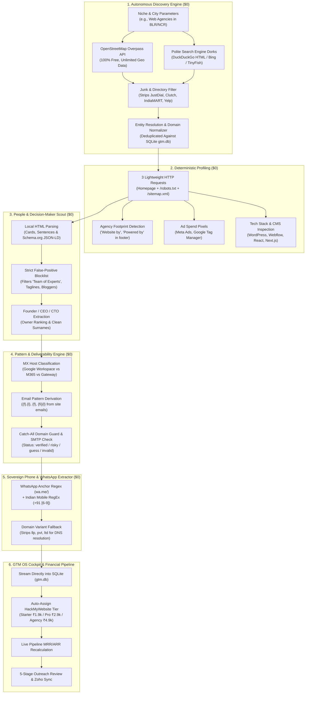
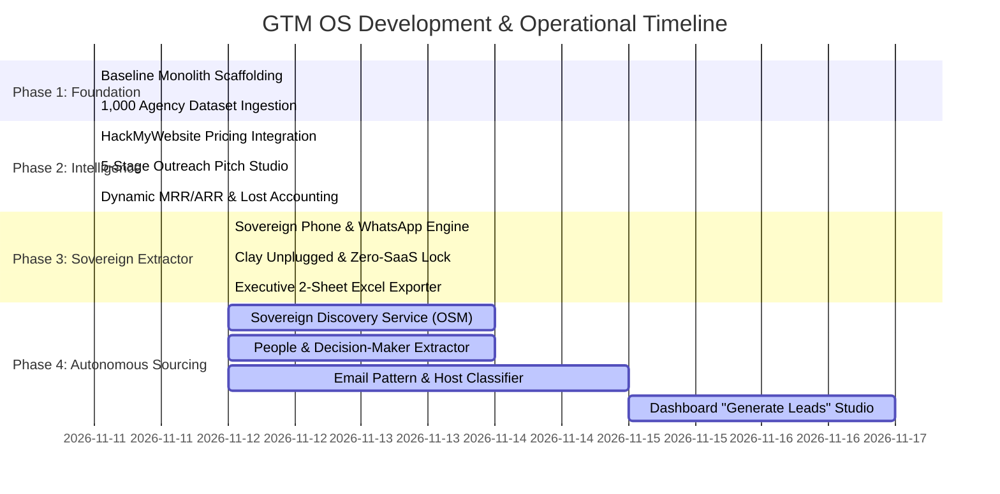
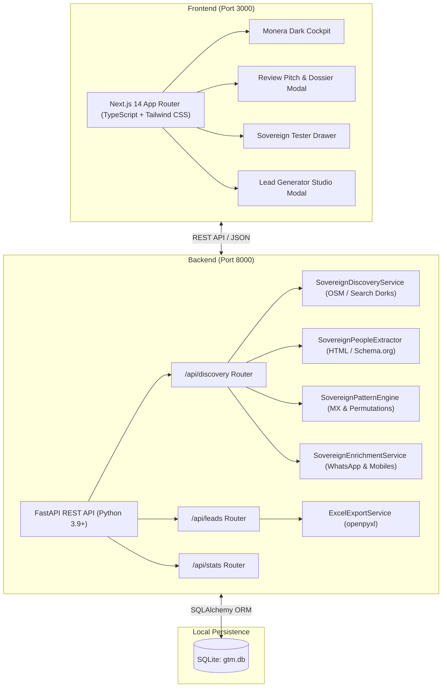
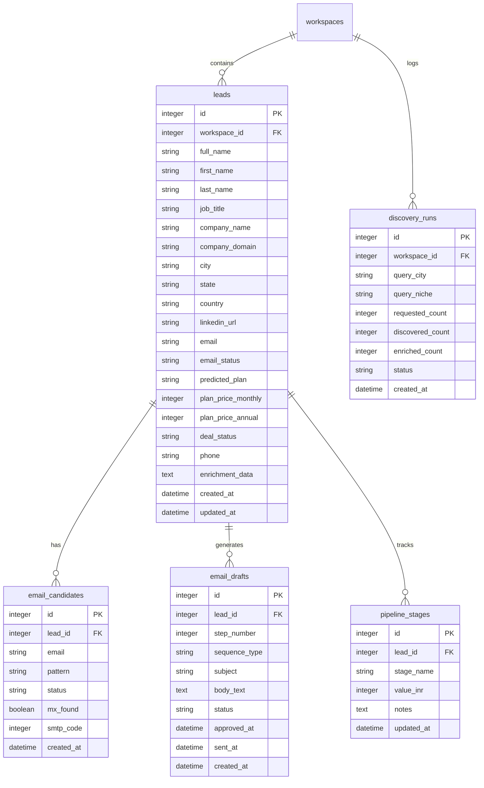

# Personal GTM Operating System (AIVI GTM OS)
## Master Unified Specification: Statement of Work (SOW), Product Requirements (PRD) & Technical Requirements (TRD)

**Version:** 3.0 — Autonomous Discovery & Sovereign Engine Baseline  
**Date:** 12 November 2026  
**Status:** Approved for Implementation & Integrated into Operational Monolith  
**Project Owner & Primary Operator:** Rishikesh Raj (Chief Operating Officer, COO)  
**Executive Sponsor:** Abhishek Mishra (Chief Executive Officer, CEO)  
**Primary Pilot Product:** HackMyWebsite (`https://hackmywebsite.io/`)  
**Active Lead Volume:** 1,000 Sourced B2B Agencies (Expanding via Autonomous Generator)  
**Current Baseline Pipeline Value:** ₹37.66 Lakhs / Month (₹4.52 Crore ARR)  
**SaaS Subscription Overhead:** ₹0 / Month (100% Free & Sovereign Compute)  
**Architectural References:** Sellbird (`ethanplusai/sellbird`), Harvey (`ethanplusai/harvey`), OpenEnrich, Twenty  
**Deployment Target:** Local-first Monolith on macOS (Apple Silicon, 8 GB RAM)  

---

## Executive Summary & System Evolution

Across the modern B2B SaaS and enterprise sales landscape, outbound customer acquisition has historically been trapped in an expensive, multi-vendor subscription matrix costing **\$400 to \$800+ monthly (₹35,000–₹70,000/mo)**:
1. **Lead Database & Discovery:** Apollo / ZoomInfo (\$99–\$250/mo)
2. **Phone & Contact Enrichment:** Lusha / Kaspr / Clay (\$100–\$300/mo)
3. **Email Verification:** Hunter / NeverBounce / ZeroBounce (\$49–\$99/mo)
4. **Outreach Sequencing:** Instantly / Lemlist / Apollo Sequences (\$59–\$149/mo)
5. **CRM & Deal Pipeline:** HubSpot / Pipedrive (\$50–\$150/mo)

The **Personal GTM Operating System (AIVI GTM OS)** eliminates this recurring software tax by providing a single, local-first monolith designed to operate at **strictly ₹0 monthly SaaS spend**. 

Having already operationalized the core terminal—incorporating 1,000 validated Indian web development agencies, 5-stage contextual outreach sequences, dynamic MRR/ARR financial accounting, and sovereign WhatsApp/phone extraction—**Version 3.0 expands the system with an Autonomous Sovereign Lead Generator Engine**.

By reverse-engineering the data acquisition pipelines of Apollo, Clay, and the open-source architectures of **Sellbird** (`ethanplusai/sellbird`) and **Harvey**, the GTM OS introduces a self-contained sourcing loop:
* **Account Discovery:** Free geographic indexing via the OpenStreetMap (OSM) Overpass API and polite search queries, cleansed of directories via regex patterns.
* **Deterministic Profiling:** 3-request HTTP inspection extracting tech stacks, ad spend signals (Meta Ads, Google Tag Manager), and agency footer credits.
* **Decision-Maker Extraction:** Direct extraction of Owners, Founders, CEOs, and CTOs from target websites and Schema.org structured data without third-party scrapers.
* **Pattern & Deliverability Engine:** Derives company email patterns (`{f}.{l}`, `{f}`, `{fi}{l}`) from public addresses, classifies mail servers (Google Workspace, Microsoft 365, Gateways), detects catch-alls, and verifies mailboxes.
* **Sovereign Phone Intelligence:** Automatically uncovers direct WhatsApp links (`wa.me/`) and validated 10-digit Indian mobile numbers (`+91 [6-9]`).

---

# SECTION 1: STATEMENT OF WORK (SOW)

## 1.1 Commercial Baseline & Zero-SaaS Replacement Matrix

The Personal GTM OS replaces the traditional SDR and data enrichment software stack with sovereign code running entirely on local hardware:

| Legacy Commercial Tool | Replaced Function | Monthly Cost | GTM OS Sovereign Replacement | GTM OS Cost |
| :--- | :--- | :---: | :--- | :---: |
| **Apollo.io (Pro)** | Agency Discovery & Lead DB | \$99 / mo | OpenStreetMap + Search Dorks (`discover.py`) | **₹0** |
| **Clay.com (Explorer)** | Waterfall Enrichment | \$149 / mo | `SovereignEnrichmentService` (Python) | **₹0** |
| **NeverBounce / Hunter** | Email Verification & Patterns | \$49 / mo | `SovereignPatternEngine` + RFC 5321 | **₹0** |
| **LinkedIn Sales Navigator** | Decision-Maker Research | \$99 / mo | `SovereignPeopleExtractor` (`people.py`) | **₹0** |
| **Instantly / Lemlist** | Cold Outreach Sequencing | \$59 / mo | 5-Stage Pitch Studio + Zoho Fast-Dispatch | **₹0** |
| **HubSpot CRM (Starter)** | Deal Pipeline & Revenue Tracking | \$50 / mo | Dynamic Deal Pipeline & Lost MRR Engine | **₹0** |
| **Total Monthly Spend** | **Consolidated SDR Software Stack** | **\$505 / mo (~₹42,500/mo)** | **Unified Local Monolith Cockpit** | **₹0 / Month** |

---

## 1.2 Master Scope of Workstreams (v3.0)

### Workstream 1: Autonomous Account Discovery (`sovereign_discovery_service.py`)
* Implements free geographic account discovery via the **OpenStreetMap (OSM) Overpass API**, querying nodes and ways tagged as digital agencies, web developers, and IT consultancies across Indian tech hubs (Bengaluru, Delhi-NCR, Mumbai, Pune, Hyderabad, Chennai, Ahmedabad).
* Implements polite web search queries (via DuckDuckGo HTML, Bing, and TinyFish) using targeted keyword dorks.
* Applies `JUNK_DOMAIN_PATTERNS` to filter out directories, portals, and media aggregators (JustDial, Sulekha, IndiaMART, Yelp, Clutch, Wikipedia, Medium, LinkedIn directories).
* Implements canonical entity resolution: domain normalization (strips `https://`, `www.`, tracking parameters) and deduplication against existing SQLite records.

### Workstream 2: Deterministic Company Profiling (`sovereign_profiler.py`)
* Executes exactly 3 lightweight, asynchronous HTTP requests per company: Homepage, `/robots.txt`, and `/sitemap.xml` (falling back to `/contact`).
* Inspects HTML for incumbent agency footprints (detects *"Website by"*, *"Designed by"*, *"Powered by"* in footers with confidence scoring).
* Detects paid marketing signals: Meta Pixel (`fbevents.js`), Google Ads Conversion (`gtag`), and Google Tag Manager.
* Inspects technology stack (WordPress, Webflow, Shopify, React, Next.js) and security headers (CSP, HSTS, X-Frame-Options) to supply personalized hooks for HackMyWebsite pitches.

### Workstream 3: Decision-Maker Extraction (`sovereign_people_extractor.py`)
* Extracts key decision-makers (Founders, Co-Founders, CEOs, Managing Directors, CTOs, Technical Partners) directly from the target company's website.
* Crawls up to 6 internal pages: `/about`, `/team`, `/leadership`, `/our-story`, `/management`, `/contact`.
* Evaluates three distinct HTML structures:
  1. **Cards & Lists:** Name tokens immediately preceding or succeeding a role title inside `
`, ``, `
`, or ` ` tags.
  2. **Prose Sentences:** Natural language attribution patterns (e.g. *"Led today by CEO..."*, *"Started in 2020 by Founder..."*).
  3. **Schema.org Structured Data:** Reads `<script type="application/ld+json">` for `founder`, `foundingLocation`, and `employee` entities.
* Applies a strict `COMMON_WORDS` false-positive blocklist (excluding headings like *"Team of Experts"*, *"Family Owned"*, *"Meet the Team"*).
* Implements the `split_person_name` tokenizer: removes honorifics (`Dr.`, `Mr.`), middle initials, and professional suffixes (`MBA`, `PMP`, `Esq.`).

### Workstream 4: Email Pattern Derivation & Deliverability (`sovereign_pattern_engine.py`)
* Resolves domain MX priority records via `aiodns` / `dnspython`.
* Classifies the primary mail host: Google Workspace (`aspmx.l.google.com`), Microsoft 365 (`protection.outlook.com`), Secure Gateway (Mimecast, Proofpoint, Barracuda), or Self-Hosted.
* Analyzes all public email addresses scraped from the target website to derive the organization's dominant format (`{f}.{l}`, `{f}{l}`, `{fi}{l}`, `{f}`, `{fi}.{l}`).
* Generates primary and candidate email permutations.
* Flags catch-all domains (`status: risky`) and self-hosted dead mailboxes (`status: invalid`) to protect domain reputation.

### Workstream 5: Sovereign Phone & WhatsApp Intelligence (`sovereign_enrichment_service.py`)
* Inspects HTML anchors for direct WhatsApp links (`wa.me/`, `api.whatsapp.com/send?phone=`) to extract mobile numbers with 100% confidence.
* Applies the robust Indian Mobile RegEx: captures 10-digit series starting with 6, 7, 8, or 9 across all spacing and prefix variants (`+91 98145 45259`, `98145-45259`, `09814545259`).
* Distinguishes personal mobiles from office landlines (`011`, `022`, `080`, `0120` STD codes).
* Implements corporate suffix normalizer: automatically tests clean domain variants when legal entity handles fail DNS resolution (e.g. `softerectorllp.com` ➔ `softerector.com`).
* Generates one-click WhatsApp chat links (`https://wa.me/91{10_digits}`).

### Workstream 6: Commercial Pricing & Dynamic Revenue Engine
* Maps incoming agencies to HackMyWebsite's commercial SaaS tiers:
  * **Starter Tier:** ₹1,999 / month (₹23,988 / year) — boutique studios (1–5 engineers).
  * **Pro Tier:** ₹2,999 / month (₹35,988 / year) — mid-market web agencies.
  * **Agency Tier:** ₹4,999 / month (₹59,988 / year) — primary default tier for full-service development agencies.
  * **Enterprise Tier:** ₹9,999 / month (₹1,19,988 / year) — multi-office / enterprise agency networks.
* Maintains live financial pipeline calculations:
  * `estimated_mrr_inr`: Sum of predicted monthly fees across all active leads.
  * `estimated_arr_inr`: `estimated_mrr_inr * 12`.
  * `lost_mrr_inr`: Real-time sum of monthly revenues for leads marked "Said No".
  * `won_mrr_inr`: Real-time sum of closed-won deals.

### Workstream 7: Contextual 5-Stage Outreach Studio & Fast-Dispatch
* Renders deep prospect dossiers with 5 tailored email sequence tabs:
  1. `initial_cold`: Contextual cold pitch grounded in the agency's tech stack and client security retainers.
  2. `demo_walkthrough`: Product walkthrough invitation following a positive response.
  3. `followup_day3`: Soft reminder referencing the initial pitch.
  4. `breakup_day7`: Courteous door-open break-up note.
  5. `rejection`: Graceful relationship nurture if the agency declines.
* Built-in one-click clipboard copy actions ("Copy Subject", "Copy Body") and "Mark Sent from Zoho" status updater.

### Workstream 8: Executive Reporting & 2-Sheet Excel Exporter
* `GET /api/leads/export/excel`: Generates a professional 2-sheet formatted `.xlsx` workbook:
  * **Sheet 1 (Leads & Pricing):** Contact details, company, domain, email, candidates, phone, predicted plan, pricing, and deal status.
  * **Sheet 2 (Outreach Pitches):** Full outreach copy (subject and body) for every account.
* `GET /api/leads/export/csv`: Fast, lightweight CSV export.

---

## 1.3 Phased Implementation Matrix (v3.0)

---

# SECTION 2: PRODUCT REQUIREMENTS DOCUMENT (PRD)

## 2.1 Product Vision, ICP & Personas

The Personal GTM OS is an executive outbound cockpit that empowers a lean executive team (COO and CEO) to discover, research, verify, and close B2B accounts at scale without monthly software bills.

### Target Ideal Customer Profile (ICP):
* **Industry:** Custom Web Development Agencies, Software Engineering Studios, WordPress/Webflow Agencies, Mobile App Houses, Digital Transformation Consultancies.
* **Geography:** India (Primary: Bengaluru, Delhi-NCR, Mumbai, Pune, Hyderabad, Chennai, Ahmedabad).
* **Company Size:** 5 to 150 employees (agencies with active client maintenance retainers).
* **Target Roles:** Founder, Co-Founder, Chief Executive Officer (CEO), Managing Director (MD), Chief Technology Officer (CTO), Partner.
* **Core Pain Point Addressed:** Web development agencies are legally and contractually liable for the security of code delivered to clients. HackMyWebsite provides automated DAST/SAST penetration testing and a GitHub PR Security Gateway that agencies white-label or bundle into high-margin client maintenance retainers.

---

## 2.2 Functional Requirements (FRD)

### Module A: Autonomous Lead Generator Studio
* **FR-A1 (Generator Controls):** The dashboard shall feature a **"⚡ Generate Net-New Leads"** control studio allowing the operator to select:
  1. *Target City / Region:* Bengaluru, Delhi-NCR, Mumbai, Pune, Hyderabad, Chennai, or Custom.
  2. *Agency Sub-Niche:* Web Development, Custom Software, Digital Studios, Mobile Apps.
  3. *Batch Target:* 50, 100, or 250 accounts.
* **FR-A2 (Zero-Cost Sourcing):** The generator shall query the OpenStreetMap Overpass API and search dorks, discarding all records matching `JUNK_DOMAIN_PATTERNS`.
* **FR-A3 (Deduplication):** System shall check candidate domains against `leads.company_domain` in SQLite; duplicates shall be skipped with provenance logged.
* **FR-A4 (Live Progress Modal):** System shall stream generation progress via server-sent events or polling: Discovered Domains ➔ Profiling Sites ➔ Extracted Executives ➔ Verified Emails & Phones ➔ Saved to Database.

### Module B: People & Decision-Maker Intelligence
* **FR-B1 (Role Targeting):** System shall specifically target: `Founder`, `Co-Founder`, `CEO`, `Managing Director`, `CTO`, `Partner`.
* **FR-B2 (Site Extraction):** System shall inspect internal pages (`/about`, `/team`, `/leadership`) and Schema.org JSON-LD to identify real human executives.
* **FR-B3 (False-Positive Elimination):** System shall reject headings and marketing slogans using the `COMMON_WORDS` filter.
* **FR-B4 (Fallback Policy):** If no named executive is published, system shall extract the verified general contact mailbox (`hello@`, `contact@`, `info@`) and tag the lead as a company-level prospect.

### Module C: Email Pattern & Verification
* **FR-C1 (Host Classification):** System shall identify the MX host (Google Workspace, Microsoft 365, Gateway, Self-Hosted).
* **FR-C2 (Pattern Derivation):** System shall deduce the corporate email format from public addresses on the domain.
* **FR-C3 (Status Tagging):** System shall classify all email candidates into: `verified`, `risky` (catch-all), `guess`, or `invalid`.
* **FR-C4 (Alt Email Selector):** Table rows and review modals shall provide an instant dropdown selector to switch active work emails.

### Module D: Sovereign Phone & WhatsApp Extractor
* **FR-D1 (Direct WhatsApp Links):** System shall extract and validate `wa.me/` and `api.whatsapp.com` links into direct one-click WhatsApp chat actions.
* **FR-D2 (Indian Mobile Validation):** System shall parse 10-digit mobile series (`+91 [6-9]`) and distinguish them from landlines.
* **FR-D3 (Domain Variant Fallbacks):** System shall automatically strip legal suffixes (`llp`, `pvt`, `ltd`) if raw domains fail resolution.
* **FR-D4 (Standalone Tester):** Dashboard shall include a dedicated modal tool to test arbitrary domains with step-by-step audit logs.

### Module E: Commercial Pricing & Deal Pipeline
* **FR-E1 (Dynamic Financials):** Each lead shall support instant plan assignment (Starter, Pro, Agency, Enterprise).
* **FR-E2 (Real-Time Pipeline Recalculation):** Switching plans or marking an agency as "Said No" shall instantly update active MRR/ARR, lost MRR, and won MRR.
* **FR-E3 (5-Stage Sequence Modal):** System shall present 5-stage sequential outreach copy with one-click copy buttons and Zoho dispatch sync.
* **FR-E4 (2-Sheet Excel Exporter):** One-click download of a multi-sheet formatted `.xlsx` workbook.

---

# SECTION 3: TECHNICAL REQUIREMENTS DOCUMENT (TRD)

## 3.1 Monolith Architecture & Technology Stack

The Personal GTM OS is implemented as a local-first, two-tier architecture:

### Component Stack Specifications:
* **Frontend:** Next.js 14.2.15 (App Router), React 18, TypeScript, Tailwind CSS, Lucide React icons.
* **Backend:** FastAPI 0.110+, Python 3.9.6 (compatible with 3.11+), SQLAlchemy 2.0+, Uvicorn ASGI server.
* **Database:** SQLite 3.54 in WAL mode (`personal-gtm-os/data/gtm.db`).
* **HTTP & Parsing Engine:** `httpx` (asynchronous client with timeout and redirect guards), `BeautifulSoup4` with `lxml`.
* **DNS & Socket Engine:** `dnspython`, `aiodns`, native socket prober.
* **Spreadsheet Generator:** `openpyxl` 3.1+.

---

## 3.2 Relational Database Schema (SQLite Models)

---

## 3.3 Core REST API Specifications

| Method | Endpoint | Request Body | Response Payload | Description |
| :--- | :--- | :--- | :--- | :--- |
| `POST` | `/api/discovery/generate-leads` | `{ city, niche, batch_size }` | `{ run_id, status: 'started' }` | Initiates autonomous OSM & SERP sourcing pass |
| `GET` | `/api/discovery/runs/{id}` | None | `{ run_id, status, progress, new_leads }` | Polls progress of an active discovery run |
| `GET` | `/api/leads` | Query: `page`, `limit`, `search`, `status` | `{ total, leads: [...] }` | Paginated lead list with phone and active email |
| `GET` | `/api/leads/{id}` | None | `{ lead, candidates, drafts }` | Full lead dossier, sequence drafts, and email candidates |
| `PUT` | `/api/leads/{id}/deal-status` | `{ deal_status, predicted_plan, deal_notes }` | `{ status: 'success', lead }` | Updates pipeline stage and recalculates MRR/ARR |
| `PUT` | `/api/leads/{id}/select-email` | `{ email, status }` | `{ status: 'success', selected_email }` | Selects active work email from candidate list |
| `POST` | `/api/leads/{id}/sovereign-enrich` | None | `{ status: 'success', phone, enrichment }` | Runs sovereign extraction and saves phone to SQLite |
| `POST` | `/api/leads/sovereign-lookup` | `{ domain, company_name, contact_name }` | `{ status: 'success', enrichment }` | Standalone lookup for any domain without DB write |
| `GET` | `/api/leads/export/excel` | None | Binary `.xlsx` stream | Generates 2-sheet formatted Microsoft Excel workbook |
| `GET` | `/api/stats/overview` | None | `{ total_leads, estimated_mrr_inr, lost_mrr_inr, ... }` | Returns live aggregate metrics (MRR, ARR, Lost) |

---

## 3.4 Formal Approval & Baseline Sign-Off

This unified SOW, PRD, and TRD document forms the binding specification of the Personal GTM Operating System as finalized on 12 November 2026.

| Role | Name | Designation | Status | Date |
| :--- | :--- | :--- | :---: | :---: |
| **Project Owner & Operator** | Rishikesh Raj | Chief Operating Officer (COO) | **Approved** | 12 November 2026 |
| **Executive Sponsor** | Abhishek Mishra | Chief Executive Officer (CEO) | **Approved** | 12 November 2026 |

------------------------------------------------------------------------
**End of Master Unified Specification (v3.0)**
