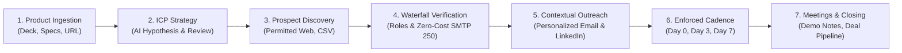
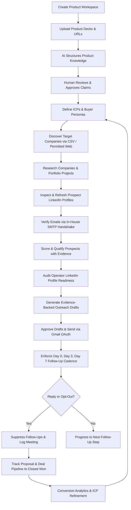
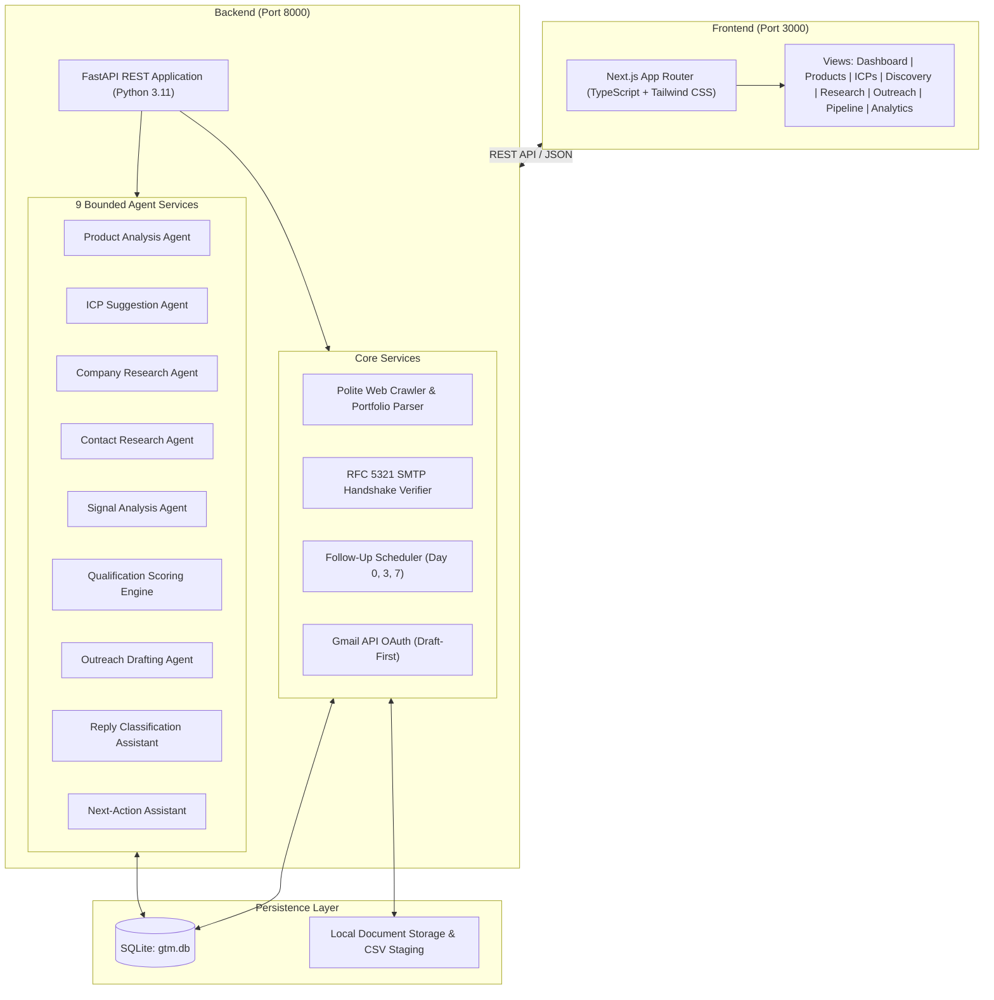
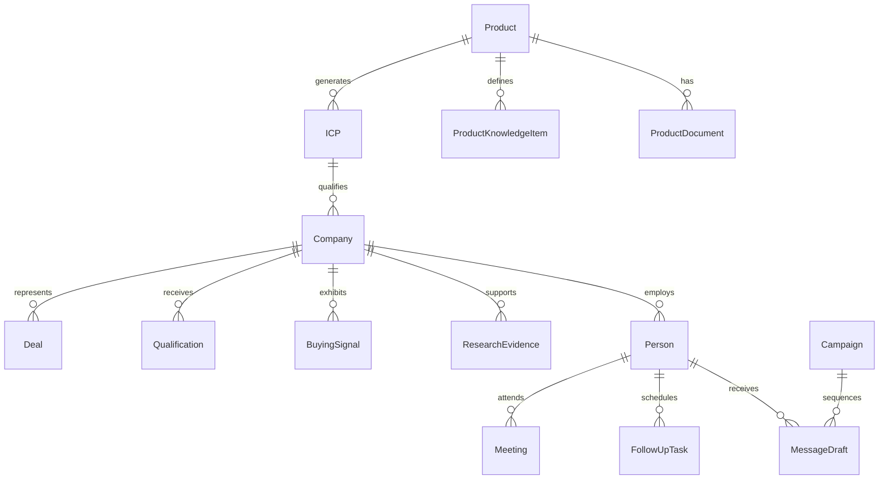
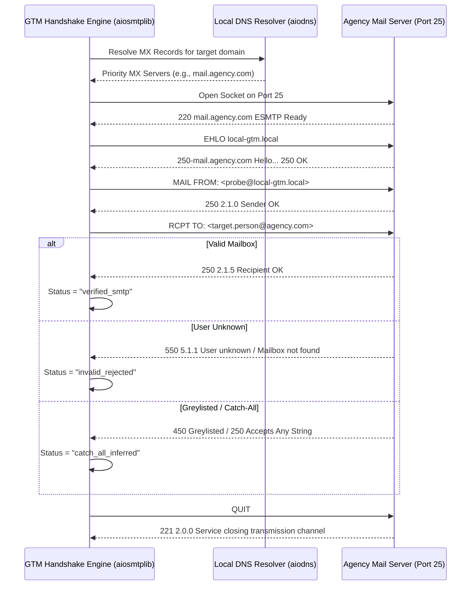

# Personal GTM Operating System (GTM OS)
## Master Unified Specification: Statement of Work (SOW), Product Requirements (PRD) & Technical Requirements (TRD)

**Version:** 1.0 — Final Unified Baseline  
**Date:** 11 November 2026  
**Status:** Approved for Technical Implementation  
**Project Type:** Internal, product-agnostic GTM productivity system  
**Initial Pilot Product:** HackMyWebsite (`https://hackmywebsite.io/`) — first configured product, not hardcoded  
**Project Owner & Primary Operator:** Rishikesh Raj (COO)  
**Business Sponsor & Executive Reviewer:** Abhishek Mishra (CEO)  
**Initial Budget Target:** ₹0 in software subscriptions and paid APIs  
**Deployment Target:** Local-first, single-user environment on macOS (Apple Silicon, 8 GB RAM)  

---

## Executive Summary & System Overview

Across the modern B2B SaaS and agency ecosystem, customer acquisition and outbound distribution are fragmented across 4 to 5 separate subscription platforms costing **\$200–\$300+ monthly**:
1. **Apollo / ZoomInfo** — Initial prospect discovery and lead database lookup.
2. **Lusha / Kaspr** — Contact and phone number enrichment.
3. **Clay** — Data waterfall orchestration and AI attribute enrichment.
4. **Instantly / Lemlist** — Cold email sequencing and scheduled dispatch.
5. **Separate CRM (HubSpot / Pipedrive)** — Deal stage and meeting pipeline tracking.

Despite this software spend, the output is frequently cold, generic, and disconnected from the underlying product's true positioning.

The **Personal GTM Operating System (GTM OS)** consolidates this entire pipeline into a single, unified, local-first platform designed to run at **₹0 in recurring software subscriptions**. It ingests actual product collateral (pitch decks, feature decks, product URLs), extracts validated Ideal Customer Profiles (ICPs), discovers matching accounts, verifies decision-makers via in-house verification heuristics (including zero-cost SMTP handshakes), generates evidence-backed personalized outreach, automates follow-up cadences, and tracks conversions through to closed revenue.

Initially validated using **HackMyWebsite** targeting web development agencies and custom software houses, the architecture is **product-agnostic**—allowing AIVI to onboard future products (such as NYAYA-DRAFT or AiVi Campus OS) through the UI without rewriting application code.



---

# SECTION 1: STATEMENT OF WORK (SOW)

## 1.1 Business Problem & Objectives

### Problem Statement
Current B2B sales operations suffer from:
- Product knowledge scattered across disconnected decks, docs, and notes.
- Tool switching across Apollo, Lusha, Clay, LinkedIn, and CRM spreadsheets.
- Time-consuming prospect research lacking verifiable source evidence.
- Disconnected outreach copy that invents familiarity or prospect pain points.
- Missed follow-ups and lost pipeline visibility.
- Substantial subscription overhead (\$2,400–\$3,600/year).

### Core Objectives
1. **Product-Agnostic Engine:** Onboard multiple products without code changes; HackMyWebsite is the validation product.
2. **Knowledge Synthesis:** Convert user-supplied materials and permitted web pages into an inspectable, human-approved product profile.
3. **Strategy Formulation:** Generate versioned ICPs and buyer personas with clear qualification criteria.
4. **Evidence-Grounded Discovery:** Discover relevant accounts from permitted public sources and user-provided CSVs with full provenance.
5. **Compliant Research:** Capture decision-maker records with field-level evidence and zero prohibited scraping.
6. **Zero-Cost Verification:** Validate work emails using native in-house RFC 5321 SMTP handshake heuristics without consuming paid credits.
7. **Two-Way LinkedIn Framework:** Enforce operator profile readiness while providing a 1-click external inspection action for prospect profile updates.
8. **Contextual Outreach:** Generate evidence-backed cold email and LinkedIn drafts requiring explicit human approval.
9. **Automated Cadence:** Enforce a strict Day 0 ➔ Day 3 ➔ Day 7 follow-up schedule with instant suppression on reply or opt-out.
10. **Native CRM & Deal Pipeline:** Track deals from first discovery to closed revenue with notes, proposals, and win/loss analysis.
11. **Cost & Safety Controls:** Zero mandatory paid APIs; local-first deployment on macOS Apple Silicon.

---

## 1.2 Detailed Workstreams & Scope Breakdown

### Workstream A — Product Onboarding & Intelligence
- Create, edit, archive, and select multiple product workspaces.
- Ingest product URL, pitch deck, feature deck, brochure, pricing tiers, differentiators, and claims to avoid.
- Extract structured knowledge items labeled: `human_confirmed`, `source_extracted`, `ai_inferred`, `missing`, or `rejected`.
- Require explicit human sign-off before any claim is used in outbound messaging.

### Workstream B — ICP & GTM Strategy
- Define multiple ICPs per product (e.g., ICP A: Custom Web Development Agencies; ICP B: Software Development Companies; ICP C: Digital Transformation Agencies).
- Define company attributes, geography, buyer personas (Founder, CEO, CTO, Technical Director), pain points, and exclusion rules.
- Set scoring weights and minimum qualification thresholds.

### Workstream C — Prospect Discovery
- Ingest user-provided CSV/XLSX files with flexible column mapping and validation.
- Controlled public web discovery from permitted directories and portfolios.
- Domain normalization and canonical deduplication.
- Retain source provenance and timestamps for every record.

### Workstream D — Company & Contact Research
- Analyze public company websites, case studies, and maintenance offerings for security-relevant evidence.
- Identify decision-maker roles (Founder, CEO, Managing Director, CTO, Technical Director, Head of Engineering, Partnerships Lead).
- **Prospect Profile Freshness & Verification:** Provide a 1-click external inspection link for the operator to verify that the prospect is actively employed at the agency, recording `profile_last_inspected_at`, `current_role_confirmed`, and `recent_focus_notes` before generating outreach.

### Workstream E — Compliant LinkedIn Research Integration
- **Strictly Permitted:** Store reference LinkedIn URLs, 1-click external browser inspection, manual note capture, and official LinkedIn API products/scopes only where explicitly approved.
- **Strictly Prohibited:** Zero unauthorized scraping, zero headless browser bots, zero session-cookie hijacking, and zero automated connection/messaging bots.

### Workstream F — Enrichment & Zero-Cost Verification
- Provider-independent enrichment interface with configurable waterfall logic.
- **In-House RFC 5321 SMTP Handshake Engine:** Query domain MX priority records and execute a direct Port 25 socket probe (`HELO ➔ MAIL FROM ➔ RCPT TO`) to verify `250 OK` recipient acceptance without sending email.
- Accurate status tagging: `verified_smtp`, `catch_all_inferred`, `invalid_rejected`, `unverified`.
- Reference open-source architectures from `openenrich/openenrich` and `debpalash/OpenGTM`.

### Workstream G — Buying Signals & Intent Engine
- Track observable business triggers: hiring activity, new service launches, company expansions, portfolio updates, and technology changes.
- Label signals as `possible_trigger` or `potential_relevance`—never assert confirmed buying intent without explicit prospect statements.

### Workstream H — Qualification & Prioritization
- Calculate transparent company-fit, persona-fit, evidence-confidence, and signal-relevance scores (0–100).
- Expose all scoring components and provide manual human overrides with recorded reasons.

### Workstream I — Outreach & Engagement
- **Operator LinkedIn Profile Prerequisite:** Provide a readiness checklist ensuring the operator's personal profile (headline, about summary, and featured proof points for HackMyWebsite) is updated prior to LinkedIn campaigns, establishing domain authority and maximizing reply rates (30%–45%).
- Generate personalized first-touch emails, follow-ups, and LinkedIn connection notes grounded in verified company evidence (leveraging prompt schemas from `eracle/OpenOutreach`).
- **Enforced Follow-Up Cadence:** Rigorously enforce:
  - **Day 0:** Approved initial outreach sent.
  - **Day 3:** Follow-up #1 scheduled, contextually referencing initial outreach.
  - **Day 7:** Follow-up #2 (soft close / break-up inquiry) scheduled.
  - **Day 14:** Non-responsive accounts transitioned into dormant quarterly loop.
- Draft-first by default; explicit human approval required before sending.
- Gmail API integration via official OAuth 2.0 (`gmail.compose` minimal scope).

### Workstream J — Native CRM & Deal Pipeline
- Maintain companies, people, leads, activities, tasks, meetings, opportunities, and deals.
- Pipeline stages: `New` ➔ `Qualified` ➔ `Contacted` ➔ `Replied` ➔ `Meeting Booked` ➔ `Proposal Sent` ➔ `Negotiation` ➔ `Won` / `Lost` / `Disqualified`.
- Record meeting notes, objections, requirements, deal values, expected close dates, and loss reasons.

### Workstream K — Analytics & Command Centre
- Funnel reporting by product, ICP, campaign, and source.
- Conversion tracking: prospects discovered ➔ qualified ➔ outreach approved ➔ sent ➔ replies ➔ positive replies ➔ meetings ➔ proposals ➔ won deals.
- Always display explicit date ranges and denominators.

### Workstream L — Administration, Security & Operations
- Local-first configuration running on `localhost`.
- Secure secret management via environment variables (`.env`).
- One-click database backup and restore for SQLite.
- CSV data export and audit logging.
- Global **"Pause All Automation"** emergency control.

---

## 1.3 Phased Implementation Roadmap

| Phase | Milestone Name | Scope & Deliverables | Exit Criteria |
| :--- | :--- | :--- | :--- |
| **Phase 0** | **Environment & Foundation** | Machine audit, local monorepo scaffolding, database setup, and documentation. | App starts on `localhost`; database persists across restart. |
| **Phase 1** | **Product Intelligence** | Multi-product onboarding, document parsing, knowledge extraction, and approval UI. | User can onboard HackMyWebsite and approve knowledge items. |
| **Phase 2** | **ICP Strategy & CRM** | ICP builder, buyer personas, company/contact database schemas, and pipeline views. | Product-specific ICPs can be created, edited, and approved. |
| **Phase 3** | **Prospect Discovery & Research** | CSV importer, domain deduplication, public web crawler, and evidence attribution. | Prospect records show source URLs, timestamps, and confidence. |
| **Phase 4** | **Enrichment & SMTP Engine** | Decision-maker role matching, in-house RFC 5321 SMTP handshake, and profile refresh. | Zero-cost 250 OK verification working; prospect profile refresh UI active. |
| **Phase 5** | **Outreach & Cadence Manager** | Operator readiness check, AI copy generator, Day 0/3/7 follow-up scheduler, suppression. | Evidence-backed drafts created; immediate suppression on reply/opt-out. |
| **Phase 6** | **Pipeline & Analytics** | Meeting recorder, proposal/deal stages, conversion funnel metrics, and CSV export. | Full prospect-to-deal lifecycle tracked with audit logging. |
| **Phase 7** | **Hardening & Security** | Security audit, backup/restore verification, automated test suite, and handover docs. | All acceptance tests pass; backup/restore validated. |

---

## 1.4 In-Scope vs. Out-of-Scope Boundaries

### Strictly In-Scope:
- Multi-product local-first web application running on `localhost`.
- Complete data ownership in a local SQLite file (`gtm.db`).
- Zero-cost in-house RFC 5321 SMTP email verification.
- Draft-first Gmail OAuth integration with mandatory human approval.
- Complete CSV export and automated backup/restore.

### Strictly Out-of-Scope (Version 1.0):
- **No Headless LinkedIn Scraping Bots:** Zero automated scraping or browser extension automation to protect LinkedIn accounts from bans.
- **No Autonomous Email Blasting:** No unapproved cold email blasts; focused, high-relevance outbound only.
- **No Mandatory Paid Subscriptions:** Zero requirement for paid Apollo, Lusha, or Clay subscriptions.
- **No Multi-Tenant SaaS Billing:** No public user registration, stripe payments, or team permission tiers in the initial version.

---

# SECTION 2: PRODUCT REQUIREMENTS DOCUMENT (PRD)

## 2.1 Product Vision & Core Principles

The Personal GTM Operating System provides a unified, local-first cockpit that moves a sales operator from understanding a product to discovering accounts, researching decision-makers, validating contact details, sending personalized outreach, and closing revenue.

### Operating Principles:
1. **Product-Agnostic Core:** Workspaces, ICPs, scoring models, and outreach are data-driven, not hardcoded to a single product.
2. **Human-in-the-Loop:** AI proposes; the human operator approves product knowledge, ICPs, scores, and outbound messages.
3. **Evidence Before Claims:** Every research statement must cite a source URL, retrieval date, and confidence level.
4. **Draft-First Communication:** No external message is ever sent without explicit user review and confirmation.
5. **Zero Fabrication:** Never invent company metrics, contact emails, buying signals, or campaign results.
6. **Permitted Integrations Only:** Strict adherence to website terms, `robots.txt`, and official API permissions.
7. **Zero-Subscription Viability:** Fully functional using local compute, free-tier APIs, and public data.

---

## 2.2 Core User Journey



---

## 2.3 Detailed Module Requirements & Priorities

### 2.3.1 Product Onboarding & Intelligence (P0)
- **User Story:** As an operator, I want to onboard my product collateral so the system understands what I sell before proposing leads.
- **Requirements:**
  - Enter product name, website, category, description, stage, pricing, features, use cases, and prohibited claims.
  - Upload pitch decks, feature decks, brochures, and technical documentation (PDF/TXT/HTML).
  - Extract knowledge items labeled: `human_confirmed`, `source_extracted`, `ai_inferred`, `missing`, or `rejected`.
  - Editable review screen requiring explicit user approval before claims are active.
  - Multi-product switching in the navigation bar.

### 2.3.2 ICP & Buyer Persona Engine (P0)
- **User Story:** As an operator, I want AI to propose structured ICPs so I can target the right agency profiles.
- **Requirements:**
  - Suggest ICP hypotheses based on approved product knowledge (e.g., Web Development Agencies, Custom Software Houses).
  - Fields: industry, sub-industry, geography, company size range, buyer personas, pain points, buying triggers, value proposition, and exclusion rules.
  - Full edit, approve, reject, duplicate, and versioning controls.
  - Prospect discovery is locked until at least one ICP is approved.

### 2.3.3 Prospect Discovery & Ingestion (P0)
- **User Story:** As an operator, I want to import agency lists or discover them from public directories while avoiding duplicates.
- **Requirements:**
  - CSV/XLSX import with column mapping (company name, domain, website, location, notes).
  - Polite crawling of permitted public directories and associations.
  - Normalized domain deduplication (`example.com` matches `https://www.example.com/`).
  - Strict preservation of source provenance, date, and import metadata.

### 2.3.4 Company Research & Qualification (P0)
- **User Story:** As an operator, I want to inspect an agency's portfolio and services to understand why they fit my product.
- **Requirements:**
  - Scrape permitted public pages (services, portfolio, case studies, maintenance retainers).
  - Extract web application indicators, tech stacks, and security compliance evidence.
  - Calculate an explainable ICP match score (0–100) with itemized score components.
  - Allow human override with recorded reasons; distinguish facts from inferences.

### 2.3.5 Contact Intelligence & Profile Refresh (P0)
- **User Story:** As an operator, I want to identify key decision-makers and verify their current agency role before drafting outreach.
- **Requirements:**
  - Target roles: Founder, CEO, Managing Director, CTO, Technical Director, Head of Engineering, Partnerships Lead.
  - Store: full name, title, company, public profile URL, business email, verification status, and confidence.
  - **1-Click Profile Refresh Action:** Open the prospect's LinkedIn profile in an external browser tab, verify active tenure, and record `recent_focus_notes` with `current_role_confirmed = True` and timestamp `profile_last_inspected_at`.

### 2.3.6 In-House Email Verification Engine (P1)
- **User Story:** As an operator, I want to verify prospect email addresses at ₹0 cost without subscribing to verification tools.
- **Requirements:**
  - Query domain DNS MX priority records.
  - Conduct an RFC 5321 socket handshake on Port 25 (`HELO ➔ MAIL FROM ➔ RCPT TO`) checking for `250 OK`.
  - Classify results: `verified_smtp`, `catch_all_inferred`, `invalid_rejected`, `unverified`.
  - Zero emails dispatched during verification (`QUIT` issued immediately after `RCPT TO`).

### 2.3.7 Buying Signals & Intent Engine (P1)
- **User Story:** As an operator, I want to detect business triggers so my outreach arrives at the right moment.
- **Requirements:**
  - Detect observable signals: hiring activity for engineers/PMs, new service announcements, client wins, tech stack updates.
  - Label every signal with source URL, timestamp, confidence, and `possible_trigger` status.

### 2.3.8 Outreach Drafting & Operator Profile Readiness (P0)
- **User Story:** As an operator, I want evidence-backed email and LinkedIn drafts sent from an authoritative profile.
- **Requirements:**
  - **Operator Profile Readiness Checklist:** Verify that the operator's personal profile (headline, about section, and featured HackMyWebsite link) is updated before launching LinkedIn outreach.
  - Generate personalized cold emails, follow-ups, and LinkedIn connection notes citing actual company evidence.
  - Editable variants with campaign tagging and version history.
  - Human approval gate required before any message is queued or sent.

### 2.3.9 Enforced Cadence & Reply Management (P0)
- **User Story:** As an operator, I want follow-ups automatically scheduled and immediately paused when a prospect responds.
- **Requirements:**
  - Enforce cadence: **Day 0 (Initial) ➔ Day 3 (Follow-up 1) ➔ Day 7 (Follow-up 2) ➔ Day 14 (Dormant loop)**.
  - Immediate suppression: Any reply, unsubscribe, refusal, or do-not-contact status cancels all pending follow-up tasks.
  - Draft creation via official Gmail OAuth 2.0 (`gmail.compose`).

### 2.3.10 Native Deal Pipeline & Analytics (P0/P1)
- **User Story:** As an operator, I want to track deals from qualified leads to closed revenue and understand which ICPs convert.
- **Requirements:**
  - Kanban and table views for deal stages (`New` to `Won`/`Lost`).
  - Log meeting notes, requirements, objections, deal value, currency, and loss reasons.
  - Analytics dashboard reporting qualification rates, reply rates, meeting conversion, and deal totals by ICP and campaign.
  - 1-click CSV data export and automated local SQLite backup.

---

# SECTION 3: TECHNICAL REQUIREMENTS DOCUMENT (TRD)

## 3.1 Architecture Style & Topology

The system is implemented as a **modular local-first monolith** running entirely on `localhost`:



### Resource Budget (Optimized for 8 GB RAM Mac):
- **FastAPI Backend:** ~120 MB RAM.
- **Next.js Dev Server:** ~250 MB RAM.
- **SQLite Engine:** In-process (negligible).
- **Total System Footprint:** **< 450 MB RAM**, leaving over 7.5 GB RAM free for browser multitasking without memory swapping.

---

## 3.2 Normalized Relational Data Schema



### Complete Entity Definitions (32 Core Entities):
1. **`Product`**: `id`, `name`, `website`, `category`, `description`, `stage`, `pricing_model`, `status`, `created_at`, `updated_at`.
2. **`ProductDocument`**: `id`, `product_id`, `filename`, `file_type`, `storage_path`, `checksum`, `parse_status`, `uploaded_at`.
3. **`ProductKnowledgeItem`**: `id`, `product_id`, `category`, `claim_text`, `source_reference`, `status` (`human_confirmed`, `source_extracted`, `ai_inferred`, `missing`, `rejected`), `approved_at`.
4. **`ProductClaim`**: `id`, `product_id`, `claim_type`, `statement`, `evidence_snippet`, `is_approved`, `approved_by`.
5. **`ProductApproval`**: `id`, `product_id`, `version_number`, `approved_items_count`, `signed_off_at`, `signed_off_by`.
6. **`ICP`**: `id`, `product_id`, `name`, `industry_tags`, `geographies`, `employee_range`, `target_roles`, `pain_points`, `buying_triggers`, `exclusions`, `status` (`draft`, `approved`, `archived`), `version`.
7. **`ICPCondition`**: `id`, `icp_id`, `field_name`, `operator`, `expected_value`, `weight`.
8. **`BuyerPersona`**: `id`, `icp_id`, `role_title`, `department`, `seniority_level`, `key_concerns`, `value_hook`.
9. **`ScoringModel`**: `id`, `product_id`, `icp_id`, `name`, `version`, `is_active`.
10. **`ScoringRule`**: `id`, `model_id`, `criterion_name`, `weight`, `rule_logic`.
11. **`ResearchProject`**: `id`, `product_id`, `icp_id`, `name`, `query_criteria`, `status`, `created_at`.
12. **`DiscoveryQuery`**: `id`, `project_id`, `source_type`, `search_string`, `results_count`, `executed_at`.
13. **`Company`**: `id`, `canonical_domain` (unique indexed), `name`, `website_url`, `location`, `description`, `services`, `employee_range`, `first_seen_at`, `last_researched_at`.
14. **`Person`**: `id`, `company_id`, `full_name`, `title`, `department`, `seniority`, `public_profile_url`, `profile_last_inspected_at`, `current_role_confirmed`, `recent_focus_notes`, `business_email`, `email_status` (`verified_smtp`, `catch_all_inferred`, `invalid_rejected`, `unverified`), `phone`, `confidence`.
15. **`Source`**: `id`, `source_type`, `url`, `retrieval_timestamp`, `status_code`, `terms_verified`.
16. **`ResearchEvidence`**: `id`, `company_id`, `person_id`, `product_id`, `claim_text`, `evidence_quote`, `source_id`, `retrieval_date`, `confidence`, `fact_or_inference`.
17. **`ContactFieldEvidence`**: `id`, `person_id`, `field_name`, `field_value`, `source_id`, `verification_method`, `verified_at`.
18. **`BuyingSignal`**: `id`, `company_id`, `signal_category`, `description`, `evidence_quote`, `source_id`, `relevance_to_product`, `observed_at`, `status`.
19. **`Qualification`**: `id`, `company_id`, `icp_id`, `score` (0–100), `rubric_version`, `score_breakdown_json`, `missing_info`, `recommendation`, `human_override_score`, `override_reason`.
20. **`IntegrationConnection`**: `id`, `provider_name`, `account_identifier`, `granted_scopes`, `is_active`, `token_ref`, `connected_at`.
21. **`EnrichmentRun`**: `id`, `company_id`, `person_id`, `provider_used`, `waterfall_step`, `status`, `started_at`, `completed_at`, `cost_incurred`.
22. **`EnrichmentResult`**: `id`, `run_id`, `raw_payload_json`, `fields_updated_json`.
23. **`Campaign`**: `id`, `product_id`, `icp_id`, `name`, `target_offer`, `channel`, `status`, `created_at`.
24. **`MessageDraft`**: `id`, `campaign_id`, `company_id`, `person_id`, `channel`, `step_number` (0, 1, 2), `subject`, `body_text`, `evidence_references_json`, `status` (`draft`, `approved`, `sent`, `suppressed`), `gmail_draft_id`, `approved_at`, `sent_at`.
25. **`MessageEvent`**: `id`, `message_id`, `event_type` (`drafted`, `approved`, `dispatched`, `replied`, `bounced`), `event_timestamp`, `event_metadata`.
26. **`FollowUpTask`**: `id`, `company_id`, `person_id`, `parent_message_id`, `cadence_step` (`day_3`, `day_7`, `dormant`), `due_date`, `status` (`pending`, `completed`, `rescheduled`, `suppressed`), `suppression_reason`.
27. **`Suppression`**: `id`, `email_address`, `domain`, `reason` (`replied`, `unsubscribed`, `refusal`, `do_not_contact`), `created_at`.
28. **`Activity`**: `id`, `company_id`, `person_id`, `activity_type`, `summary`, `timestamp`.
29. **`Meeting`**: `id`, `company_id`, `person_id`, `scheduled_time`, `attendees`, `agenda`, `meeting_notes`, `pain_points`, `objections`, `product_fit_rating`, `next_steps`.
30. **`Opportunity` / `Deal`**: `id`, `company_id`, `product_id`, `deal_name`, `deal_value`, `currency`, `stage` (`New` to `Won`/`Lost`), `expected_close_date`, `proposal_link`, `loss_reason`, `closed_at`.
31. **`Proposal`**: `id`, `deal_id`, `proposal_title`, `version`, `pricing_offered`, `terms_summary`, `delivered_at`, `status`.
32. **`AuditLog`**: `id`, `action_type`, `entity_type`, `entity_id`, `actor`, `details_json`, `created_at`.

---

## 3.3 Zero-Cost RFC 5321 SMTP Handshake Protocol



*Safeguard:* If the local internet provider blocks outbound Port 25, the engine catches the socket timeout, avoids crashing, marks the verification as `dns_mx_valid_only`, and alerts the operator.

---

## 3.4 Bounded Agent Micro-Services Architecture

Each of the 9 AI workflows is isolated as a bounded function with strict Pydantic JSON input/output schemas:

```python
# Illustrative Bounded Agent Contract
class OutreachDraftOutput(BaseModel):
    subject: str = Field(description="Contextual cold email subject line")
    body: str = Field(description="Evidence-grounded personalized email body")
    opening_hook: str = Field(description="Exact sentence connecting to agency's portfolio")
    evidence_citations: list[str] = Field(description="URLs of evidence cited")
    confidence_score: float = Field(ge=0.0, le=1.0)
```

The backend enforces state rules, rate limits, and approval gates—the LLM is never given direct write access to database records or external communication sockets.

---

## 3.5 Core API Endpoints

| Method | Endpoint | Description |
| :--- | :--- | :--- |
| `POST` | `/api/products` | Create a new product workspace |
| `GET` | `/api/products` | List all active product workspaces |
| `POST` | `/api/products/{id}/documents` | Upload and parse product collateral (PDF/DOCX) |
| `POST` | `/api/products/{id}/approve-knowledge` | Approve extracted product knowledge items |
| `POST` | `/api/products/{id}/icps` | Create or update product ICP definition |
| `POST` | `/api/discovery/csv-import` | Upload CSV prospect list with column mappings |
| `POST` | `/api/companies/{id}/research` | Trigger public web and portfolio research |
| `POST` | `/api/people/{id}/refresh-profile` | Save verified LinkedIn role and focus notes |
| `POST` | `/api/people/{id}/verify-smtp` | Run in-house RFC 5321 socket probe |
| `POST` | `/api/qualifications/score` | Calculate transparent 0–100 ICP fit score |
| `POST` | `/api/messages/draft` | Generate contextual outreach drafts |
| `POST` | `/api/messages/{id}/approve-send` | Explicitly authorize message dispatch |
| `GET` | `/api/tasks/due` | Retrieve due follow-up tasks (Day 0/3/7) |
| `POST` | `/api/suppressions` | Add an address or domain to suppression list |
| `GET` | `/api/pipeline/deals` | Retrieve Kanban deal pipeline records |
| `GET` | `/api/analytics/funnel` | Retrieve conversion funnel metrics by ICP |
| `POST` | `/api/system/pause-automation` | Emergency freeze on all background tasks |
| `POST` | `/api/system/backup` | Trigger instant local SQLite backup |

---

# SECTION 4: CANDIDATE OPEN-SOURCE FEATURE REPOSITORIES

The following public repositories were evaluated and serve as architectural benchmarks for specific capabilities without introducing subscription costs or proprietary lock-in:

| Project | Repository URL | Purpose / Architectural Inspiration |
| :--- | :--- | :--- |
| **OpenGTM** | [`debpalash/OpenGTM`](https://github.com/debpalash/OpenGTM) | Reference for end-to-end B2B pipeline flow, lead scoring rubrics, and waterfall enrichment models. |
| **OpenEnrich** | [`openenrich/openenrich`](https://github.com/openenrich/openenrich) | Direct RFC 5321 SMTP handshake (250 OK probe) heuristics, MX query routing, and zero-cost email verification. |
| **OpenOutreach** | [`eracle/OpenOutreach`](https://github.com/eracle/OpenOutreach) | Product-to-ICP discovery pipelines and evidence-grounded outreach prompt structures. |
| **Twenty** | [`twentyhq/twenty`](https://github.com/twentyhq/twenty) | Minimal CRM architecture, relationship mapping, and pipeline stage transitions. |
| **Crawl4AI** | [`unclecode/crawl4ai`](https://github.com/unclecode/crawl4ai) | Polite, LLM-ready web crawling, DOM extraction, and Markdown conversion for public company portfolios. |
| **Playwright** | [`microsoft/playwright`](https://github.com/microsoft/playwright) | Controlled browser automation for JavaScript-heavy agency portfolios (used only when standard HTTP parsing fails). |
| **LiteLLM** | [`BerriAI/litellm`](https://github.com/BerriAI/litellm) | Provider-agnostic model routing abstraction (local Ollama vs. free-tier cloud APIs) without vendor lock-in. |
| **REA** | [`morluto/rea`](https://github.com/morluto/rea) | Optional toolkit for inspecting runtime application behavior and binaries under authorized terms. |

---

# SECTION 5: IMPLEMENTATION GUARDRAILS & ACCEPTANCE

## 5.1 Antigravity Pair-Programming Directives
1. **Incremental Milestone Gates:** Implement one milestone at a time; never generate the entire application in a single unverified turn.
2. **Local-First & Cost Safety:** Keep all code, databases, and dependencies local-first. Paid APIs remain disabled by default.
3. **No Hardcoded Products:** Ensure all schemas (`Product`, `ICP`, `Campaign`) are multi-product and data-driven.
4. **Zero LinkedIn Automation Bans:** Do not write web scraping bots or automated account activity scripts for LinkedIn.
5. **Always Keep Working State:** Ensure tests pass and the application is runnable locally at the conclusion of every milestone.
6. **Maintain Project Records:** Maintain `PROJECT_STATUS.md`, `DECISIONS.md`, and `CHANGELOG.md` throughout development.

---

## 5.2 Master Acceptance Checklist

- [ ] Multi-product workspaces can be created, switched, and edited without code changes.
- [ ] Product knowledge extraction marks items as confirmed, inferred, or missing.
- [ ] Explicit human approval is required before product claims become active.
- [ ] Product-specific ICPs can be created, versioned, and edited.
- [ ] Prospect discovery requires an approved ICP.
- [ ] CSV import with column mapping and canonical domain deduplication works.
- [ ] Company research preserves source URLs, evidence quotes, and timestamps.
- [ ] Prospect profile refresh action opens external LinkedIn profiles and records notes.
- [ ] In-house RFC 5321 SMTP handshake accurately probes recipient validity on Port 25.
- [ ] Explainable 0–100 qualification scoring with human overrides and recorded reasons.
- [ ] Operator profile readiness checklist enforces headline/about optimization prior to LinkedIn outreach.
- [ ] Evidence-backed outreach drafts generated with mandatory human approval before send.
- [ ] Enforced cadence (Day 0 ➔ Day 3 ➔ Day 7) schedules tasks and halts on reply/opt-out.
- [ ] Native deal pipeline tracks opportunities from initial discovery to Won/Lost.
- [ ] Analytics dashboard reports conversion rates with explicit denominators and date ranges.
- [ ] Emergency "Pause All Automation" control freezes background operations.
- [ ] Database backup, restore, and CSV data export tested and operational.

---

## 5.3 Formal Approval & Sign-Off

This document constitutes the unified, authoritative technical specification and statement of work for the Personal GTM Operating System.

| Approver | Role | Status | Date |
| :--- | :--- | :--- | :--- |
| **Abhishek Mishra** | Business Sponsor / Chief Executive Officer (CEO) | Approved | 11 November 2026 |
| **Rishikesh Raj** | Project Owner / Chief Operating Officer (COO) | Approved | 11 November 2026 |

------------------------------------------------------------------------

**End of Master Unified Specification**
